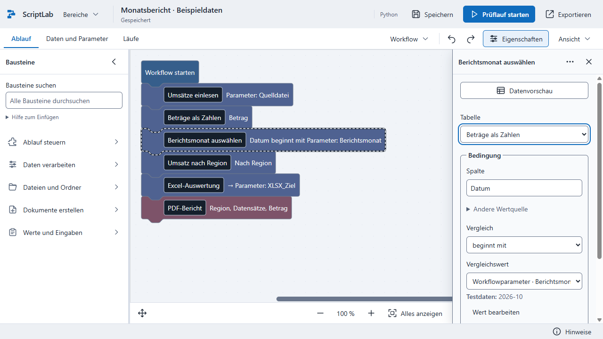
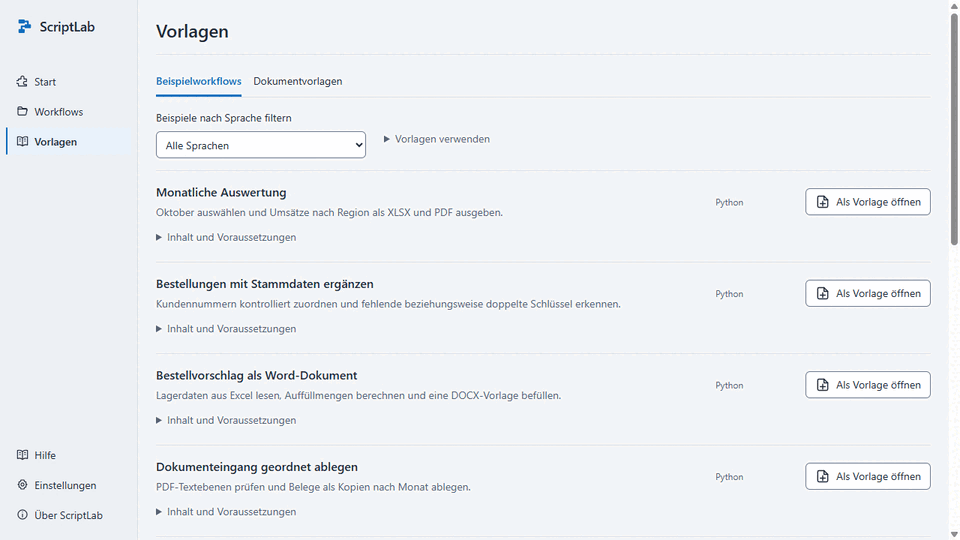
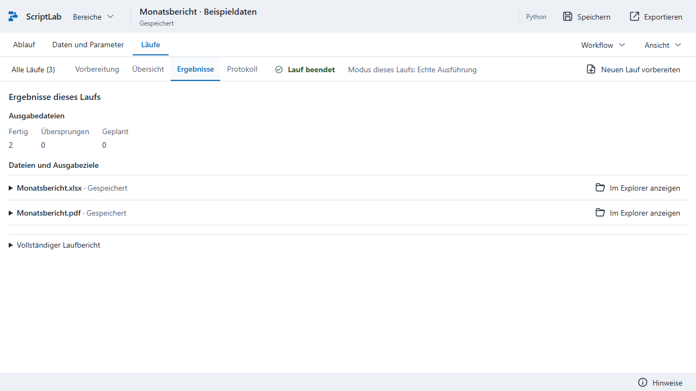

# ScriptLab

**Eigene Abläufe bauen. Wiederkehrende Arbeit abgeben.**

ScriptLab ist ein visueller Automatisierungsbaukasten für Windows. Du verbindest Bausteine, wählst deine Daten und legst fest, was passieren soll. So entstehen eigene Abläufe für die tägliche Arbeit – ohne selbst Code zu schreiben.

**Nutzung:** Privat und nichtkommerziell kostenlos. Für kommerzielle Nutzung ist eine separat zu vereinbarende kostenpflichtige Lizenz von Leon Stolz erforderlich. Preise und Umfang werden individuell vereinbart. Maßgeblich ist [LICENSE.txt](LICENSE.txt); eigene Inhalte, eigenständige Exporte und Drittanbieterrechte sind dort getrennt geregelt.

## Was du damit erledigen kannst

- **Tabellen auswerten:** CSV- und Excel-Dateien einlesen, Daten filtern, zusammenfassen und mit Stammdaten verbinden.
- **Dokumente erstellen:** Werte und Tabellen in Word-Vorlagen einsetzen oder als Excel- und PDF-Berichte ausgeben.
- **Dateien verarbeiten:** Dateien suchen, Inhalte prüfen und wiederkehrende Schritte mit Bedingungen und Schleifen verbinden.

## Vom Beispiel zum eigenen Ablauf

1. Unter **Beispielworkflows** einen passenden Ablauf als eigene Kopie öffnen.
2. Die Bausteine und ihre Eingaben anpassen. Eine Datenvorschau zeigt dir das Ergebnis unterstützter Tabellenschritte.
3. Einen **Prüflauf ohne Zieländerungen** starten. Wenn die Angaben stimmen, den Workflow bewusst ausführen.

[Lieber ein Standbild ansehen](docs/produkt/daten.png)

Mit Parametern verwendest du denselben Ablauf für andere Dateien oder Zeiträume. Unter **Läufe** findest du die zugehörigen Ergebnisse und Hinweise wieder.

## Ohne Einrichtung loslegen

ScriptLab läuft lokal unter **Windows 11 x64**. Python und die Komponenten für Tabellen und Dokumente sind enthalten. Workflows und Laufausgaben bleiben in der ScriptLab-Ablage; erst beim Export wählst du einen Speicherort.

Du kannst deine Abläufe als bearbeitbare Projektdatei, Script oder Business-Paket weitergeben. Exportierte Python-Scripts benötigen auf dem Zielrechner eine eigene Python-Umgebung. Bestehende VBS-Workflows werden ebenfalls unterstützt.

**Aktueller Stand:** ScriptLab wird noch entwickelt. Ein öffentliches Installationspaket ist bisher nicht veröffentlicht.

[Bedienung](docs/NEUE-BEDIENUNG.md) · [Beispiele und Geschäftsabläufe](docs/BUSINESS-BEDIENUNG.md) · [Entwicklung](docs/ENTWICKLUNG.md) · [Nutzung und Lizenzen](docs/ENTWICKLUNG.md#nutzung-und-lizenzen)

Entwickelt von **Leon Stolz**.
