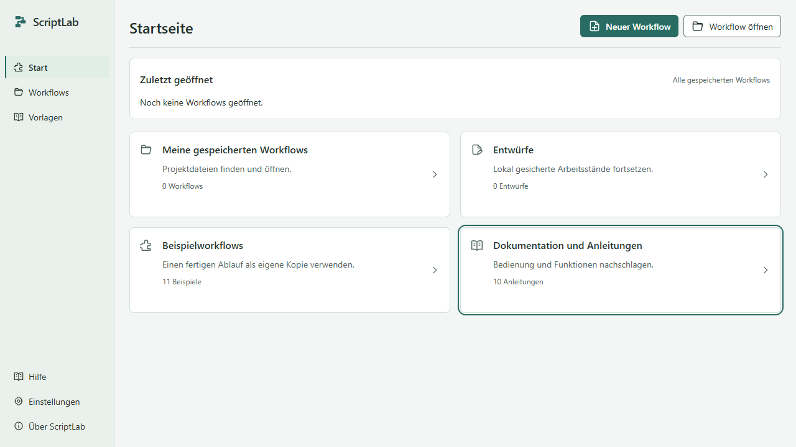
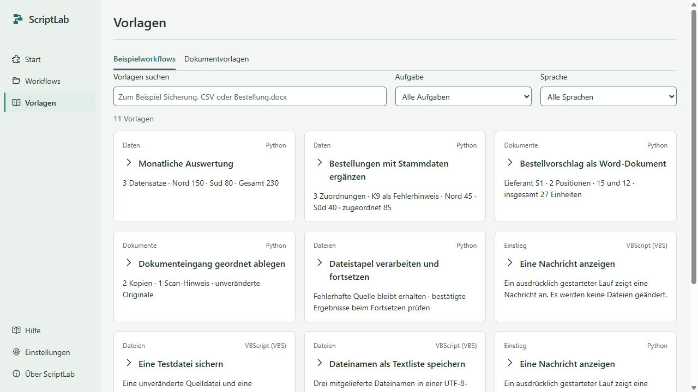
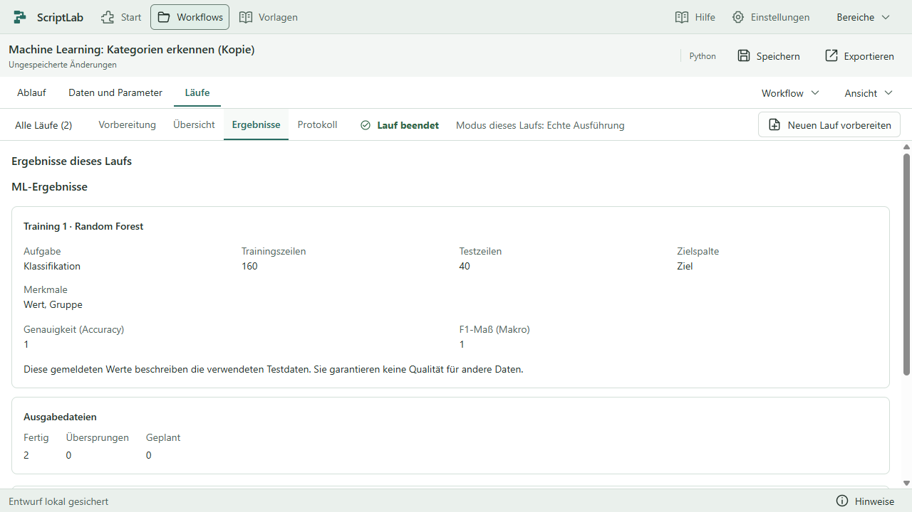
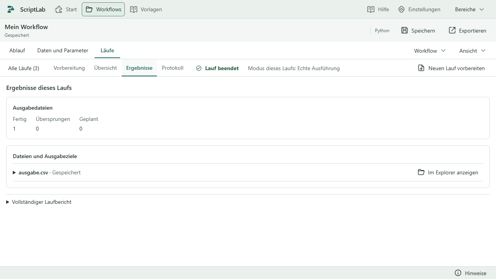

# ScriptLab

**Eigene Abläufe bauen. Wiederkehrende Arbeit abgeben.**

ScriptLab ist ein visueller Automatisierungsbaukasten für **Windows 11 x64**. Du verbindest Bausteine, konfigurierst Datenquellen und legst fest, was passieren soll – ohne selbst Code zu schreiben. Workflows werden lokal bearbeitet, bewusst getestet und ausgeführt. Erzeugte Scripts und Business-Pakete lassen sich auch ohne geöffnete ScriptLab-Anwendung verwenden.

**Nutzung:** Privat und nichtkommerziell kostenlos. Kommerzielle Nutzung erfordert eine zuvor erworbene kostenpflichtige Lizenz von **Leon Stolz**. Preis und Umfang werden gesondert vereinbart. Maßgeblich ist [LICENSE.txt](LICENSE.txt).

## Was ScriptLab kann

| Aufgabe                     | Vorhandene Funktionen                                                                                                                                                       |
| --------------------------- | --------------------------------------------------------------------------------------------------------------------------------------------------------------------------- |
| Tabellen verarbeiten        | CSV und Excel einlesen, Datentypen festlegen, filtern, sortieren, berechnen, zusammenfassen und mit Stammdaten verbinden.                                                   |
| Dokumente erstellen         | Werte und Tabellen in Word-Vorlagen einsetzen, XLSX-Dateien und PDF-Berichte erzeugen, Text aus PDFs auslesen.                                                              |
| Dateien bearbeiten          | Dateien suchen, kopieren und verschieben; Dateien und Ordner prüfen, Ordner anlegen und Abläufe mit Bedingungen oder Schleifen steuern.                                     |
| Abläufe steuern             | Variablen, Listen, Eingaben, Bedingungen, Schleifen und Workflowparameter verwenden.                                                                                        |
| Modelle mit Tabellen nutzen | In einem eigenen ML-Workflow Klassifikation oder Regression mit Random Forest beziehungsweise PyTorch auf CPU trainieren, Modelle speichern/laden und Vorhersagen erzeugen. |
| Ergebnisse nachvollziehen   | Begrenzte Datenvorschau, Laufhistorie, bestätigte Ausgaben, Hinweise, Fehler und vollständige Laufberichte ansehen.                                                         |

**Python** ist die Hauptsprache für Geschäftsprozesse, Tabellen, Dokumente und größere Aufgaben. Die Anwendung enthält CPython einschließlich Tcl/Tk und die festgelegten Business-Pakete. Für diese Grundausstattung müssen Anwender weder Python noch zusätzliche Pakete installieren. Das zusätzliche **CPU-Paket für Machine Learning** wird separat und ausdrücklich online oder aus einem vorbereiteten Offlineordner eingerichtet.

**VBScript (VBS)** bleibt für kleinere Windows-Automatisierungen und vorhandene Projekte erhalten. Die Ausführung benötigt die verfügbare Windows-VBScript-Komponente und passende Richtlinien. Die gemeinsamen Grundbausteine sind für beide Sprachen vorhanden; die zusätzlichen Business-Funktionen gehören zu Python. Ein bestehender Workflow behält seine Sprache.

**Neuer Workflow** bietet drei Karten: **Python**, **VBS** und **Machine Learning**. Machine Learning verwendet ebenfalls Python, mit einem auf Tabellen und die vier Modellaktionen begrenzten Bausteinkatalog. Ein bestehender Workflow behält seine Art; allgemeine Python-/VBS-Workflows behalten ihren bisherigen Katalog.

## Oberfläche und Arbeitsbereiche



**Start**, **Workflows**, **Vorlagen**, **Hilfe** und **Einstellungen** bilden die globale Navigation. Auf der Startseite führen Karten zu gespeicherten Workflows, Entwürfen, Beispielen und Anleitungen. **Weiterbearbeiten** kehrt zum vorhandenen Arbeitsstand zurück.

Im geöffneten Workflow stehen drei Arbeitsbereiche zur Verfügung:

| Bereich                 | Zweck                                                                                                                                                                                     |
| ----------------------- | ----------------------------------------------------------------------------------------------------------------------------------------------------------------------------------------- |
| **Ablauf**              | Im Blockly-Bausteineditor Verbindungen und Reihenfolge bearbeiten. Bausteine per Ziehen oder über Plus und eine Einfügestelle ergänzen; Eigenschaften und Codevorschau bei Bedarf öffnen. |
| **Daten und Parameter** | Bausteinangaben, Workflowparameter und unterstützte Tabellenvorschauen bearbeiten beziehungsweise prüfen.                                                                                 |
| **Läufe**               | Einen Lauf vorbereiten, starten und stoppen oder Übersicht, Ergebnisse und Protokoll eines früheren Laufs ansehen.                                                                        |

Die Vorlagen verwenden ein anpassbares Kartenraster. Laufvorbereitung, bestätigte Zusammenfassung und Ausgabedateien sind als zusammengehörige Flächen gruppiert. **Hell**, **Dunkel** und **System** sowie die Textgröße lassen sich unter **Einstellungen → Darstellung** wählen. Die Textgröße der Oberfläche ist vom Canvaszoom getrennt.

[Bausteineditor ansehen](docs/qualitaet/vorlagen-ansichten/editor-hell.png) · [Karten und weitere Ansichten](docs/qualitaet/KARTEN.md)

## Mit einer Vorlage anfangen

Die folgenden Schritte zeigen den Einstieg mit einer Python-Business-Vorlage, zum Beispiel **Monatliche Auswertung**.

1. **Vorlagen** oder auf der Startseite **Beispielworkflows** öffnen. Suche, Aufgabe und Sprache helfen bei der Auswahl.
2. Eine Karte auswählen und Ergebnis, Vorbereitung sowie enthaltene Dateien prüfen. Die Auswahl startet keinen Lauf.
3. **Als Vorlage öffnen** wählen. ScriptLab erstellt eine eigene bearbeitbare Kopie und übernimmt die mitgelieferten Testdaten in deren Arbeitsordner. Die Vorlage bleibt erhalten.
4. Bausteine, Quellen und Parameter anpassen. **Speichern** sichert den Workflow intern; für eine weiterzugebende Projektdatei dient **Exportieren**.
5. **Workflow ausführen** startet den aktuellen Ablauf sofort mit den konfigurierten Bausteinen und Parameterwerten. Vorheriges Speichern ist nicht nötig. Du bleibst im Editor und siehst Status und Ausgabe direkt über dem Ablauf; **Stoppen** ist oben erreichbar. Fehlende Pflichtangaben führen gezielt zur Korrektur.
6. **Laufdetails** öffnet bei Bedarf Ergebnisse und Protokoll. Unter **Läufe → Vorbereitung** kannst du Arbeitsordner, Zeitlimit und Parameter anpassen oder bei unterstützten Python-Business-Workflows ausdrücklich einen **Prüflauf ohne Zieländerungen** wählen. Die **Datenvorschau** bleibt separat erreichbar. Diese optionalen Prüfungen sind keine Voraussetzung für den direkten Start; der Hauptknopf führt immer wirklich aus, auch nach einer Vorschau.



Es gibt **13 Beispielworkflows**: fünf bisherige Python-Business-Vorlagen, zwei ML-Vorlagen sowie drei Einstiegsabläufe jeweils für Python und VBS. Die Einstiege zeigen eine Nachricht, sichern eine Testdatei oder schreiben Dateinamen in eine Textliste.

| Business-Vorlage                                                                          | Beispielergebnis mit den mitgelieferten Testdaten                                                                       |
| ----------------------------------------------------------------------------------------- | ----------------------------------------------------------------------------------------------------------------------- |
| [Monatliche Auswertung](beispiele/business/A-Monatsauswertung/README.md)                  | Umsätze nach Region zusammenfassen und als XLSX/PDF ausgeben: Nord 150, Süd 80, insgesamt 230.                          |
| [Bestellungen mit Stammdaten ergänzen](beispiele/business/B-Bestellungen/README.md)       | Drei Bestellungen zuordnen; K9 bleibt als Fehlerhinweis sichtbar. Zugeordneter Betrag: 85.                              |
| [Bestellvorschlag als Word-Dokument](beispiele/business/C-Bestellvorschlag/README.md)     | Zwei Positionen für einen Lieferanten in eine DOCX-Vorlage einsetzen: 15 und 12, insgesamt 27 Einheiten.                |
| [Dokumenteingang geordnet ablegen](beispiele/business/D-Dokumenteingang/README.md)        | Zwei Textbelege als Kopien ablegen; ein Scan erhält einen Hinweis. Originale bleiben erhalten.                          |
| [Dateistapel verarbeiten und fortsetzen](beispiele/business/E-Dateistapel/README.md)      | Gültige CSVs verarbeiten und nach bestätigtem Ergebnis archivieren; fehlerhafte Quellen erhalten.                       |
| [Machine Learning: Kategorien erkennen](beispiele/business/F-ML-Klassifikation/README.md) | 200 synthetische Zeilen in 160 Trainings-/40 Testzeilen teilen; ein Modell speichern und 20 neue Zeilen klassifizieren. |
| [Machine Learning: Zahlenwerte vorhersagen](beispiele/business/G-ML-Regression/README.md) | Getrennte Testdaten mit MAE/RMSE/R² bewerten; ein Modell speichern und für 20 neue Zeilen Zahlenwerte vorhersagen.      |

Unter **Dokumentvorlagen** ist die vorhandene `Bestellung.docx` dem zugehörigen Workflow zugeordnet. Sie wird mit dessen eigener Kopie verwendet. Die Beispiele enthalten synthetische Daten; ein Bestellvorschlag versendet keine Bestellung.

## Machine Learning mit Tabellendaten

Die vier Modellaktionen heißen **Modell trainieren**, **Modell speichern**, **Modell laden** und **Vorhersagen erzeugen**. Vorhandene CSV-/XLSX- und Tabellenbausteine bereiten die Daten vor und schreiben Ergebnisse. Wähle Klassifikation für Kategorien oder Regression für Zahlenwerte. Random Forest und das feste neuronale PyTorch-Netz verwenden ausschließlich die CPU. Standardmäßig bleiben 20 % der Daten für die unabhängige Testbewertung zurück; die Vorverarbeitung lernt nur aus den übrigen 80 %.

Unter **Einstellungen → Laufzeit → Machine-Learning-Komponenten** kannst du das CPU-Paket ausdrücklich online einrichten oder einen vorbereiteten Offline-Paketordner verwenden. Das Öffnen oder Auswählen eines Workflows und der Workflowstart installieren nichts. Ohne Paket bleiben Bearbeiten, Speichern und Exportieren möglich.

Vorschau und Prüflauf trainieren und speichern kein Modell. Ein vorhandenes unterstütztes Modell darf dabei lesend für Vorhersagen verwendet werden; geplante Trainingsergebnisse werden nicht als echte Vorhersagen ausgegeben. Erst die echte Ausführung trainiert beziehungsweise veröffentlicht Dateien. Die Qualitätsanzeige zeigt bestätigte Testmetriken, keine Qualitätsgarantie für neue Daten.

Die eigene `.slmodell`-Datei enthält Modell, Spaltenschema und Qualitätsangaben. Beliebige Pickle-/Joblib-Dateien oder fremde Modellarchitekturen werden nicht importiert. Modelle sind an die geprüfte Laufzeit und Lockdatei gebunden. Training ist unter anderem auf 100.000 Zeilen und 128 Eingabespalten begrenzt; dies ist keine Zusage für den gesamten Speicherbedarf. [ML-Anleitung](docs/ML.md) erklärt Einrichtung, Datenvorbereitung, Modellgrenzen und eigenständigen Export.



Der [ML-Prüfbericht](docs/qualitaet/ML-ABSCHLUSS.md) nennt ausgeführte Tests, Paketstand, Agentenaufträge und offene Grenzen einschließlich des noch ausstehenden CI-Gesamtergebnisses.

## Vorschau, Prüfung und echte Ausführung

| Aktion                                    | Was passiert?                                                                                                                                                                           |
| ----------------------------------------- | --------------------------------------------------------------------------------------------------------------------------------------------------------------------------------------- |
| **Codevorschau / Strukturprüfung**        | Zeigt erzeugten Quelltext beziehungsweise prüft den Workflow. Startet keine Verarbeitung.                                                                                               |
| **Business-Datenvorschau**                | Liest bewusst die benötigten unterstützten Tabellenschritte und zeigt höchstens 200 Zeilen beziehungsweise 256 KiB. Filter oder Gruppierungen können trotzdem die gesamte Quelle lesen. |
| **Business-Prüflauf ohne Zieländerungen** | Prüft unterstützte Schritte und geplante Ausgaben. Technische Zwischenfassungen können entstehen; fachliche Quellen und Ziele bleiben unverändert.                                      |
| **Echte Ausführung / Grundbaustein-Test** | Führt den aktuellen Workflow tatsächlich aus. Dateiänderungen und Dialoge sind echt.                                                                                                    |

Grundbausteine und VBS erhalten keinen vorgetäuschten Business-Prüflauf. Die Parametersätze **Testdaten** und **Echte Daten** sind keine Sicherheitsbereiche. **Stoppen** macht bereits erfolgte Dateiänderungen nicht rückgängig. Öffnen, Ansichtswechsel, Speichern und Export starten keinen Workflow.

Unter **Läufe** gehören Ergebnisse und Protokolle zum tatsächlich ausgeführten Workflowstand samt Parametern und Arbeitsordner. Ein früherer Stand wird kenntlich gemacht; die Historie hält keine zusätzliche Kopie jeder Ausgabedatei vor.



## Speichern, Ablage und Export

Workflows, Entwürfe, Arbeitsdateien und Laufhistorie liegen außerhalb der Installation im ScriptLab-Nutzerverzeichnis, gewöhnlich unter `%APPDATA%\ScriptLab`. Relative Pfade verwenden in der Anwendung den Arbeitsordner des jeweiligen Workflows. Externe Quellen bleiben lesbar; Schreibziele innerhalb der App müssen in der ScriptLab-Nutzerablage liegen. **Speichern** überschreibt eine extern geöffnete Projektdatei nicht. Die automatische Entwurfssicherung ersetzt das bewusste Speichern nicht.

| Export                        | Verwendung außerhalb von ScriptLab                                                                                                                                                        |
| ----------------------------- | ----------------------------------------------------------------------------------------------------------------------------------------------------------------------------------------- |
| **Projektdatei `.scriptlab`** | Bearbeitbaren Workflow in ScriptLab weiterverwenden; enthält Sprache, Bausteine, Verbindungen, Ansicht und Parameter. Ältere unterstützte Projektversionen werden beim Laden übernommen.  |
| **Python-Script `.py`**       | Gewöhnlichen Python-Workflow mit einer passenden eigenen Python-Umgebung ausführen. Dialogbausteine benötigen dort zusätzlich Tcl/Tk.                                                     |
| **VBS-Script `.vbs`**         | Mit Windows Script Host und verfügbarer VBScript-Komponente ausführen; optionale VBS-Signaturen bleiben unterstützt.                                                                      |
| **Business-Paket `.zip`**     | Python-Script, Business-Module, feste Requirements, Parametervorlage und Anleitung unabhängig nutzen. Benötigt eine eigene passende Python-Umgebung; ein Interpreter ist nicht enthalten. |

Vorlagen, Bilder und Schriften werden einem Business-Paket nur nach ausdrücklicher Ressourcenauswahl beigefügt. Geschäftsdaten, Berichte und Journale werden nicht automatisch mitgenommen. Beim eigenständigen Script beziehen sich relative Pfade standardmäßig auf den Scriptordner; absolute Pfade müssen zum Zielrechner passen. Der Scriptstart installiert keine Pakete. `.py`, `.vbs` und Business-ZIPs lassen sich nicht als bearbeitbare Projekte zurückimportieren.

Bei ML-Workflows enthält das Business-Paket zusätzlich die ML-Module, die unveränderte `requirements-ml.lock` und Lizenzhinweise. Der Empfänger richtet seine eigene passende CPU-Umgebung ausdrücklich ein. Online ist zusätzlich der offizielle PyTorch-CPU-Index nötig; offline werden beide vollständigen Wheelsätze verwendet. Die [ML-Exportanleitung](docs/ML.md#eigenständig-ohne-scriptlab-ausführen) enthält die genauen Befehle.

## Installation und Entwicklung

ScriptLab befindet sich im Entwicklungsstand **0.2.0**. Ein öffentliches Installationspaket ist bisher nicht veröffentlicht; spätere Downloads gehören auf die [GitHub-Releases-Seite](https://github.com/siggismalz/ScriptLab/releases). Lokale Testinstaller sind keine produktive Freigabe.

### Aus dem Repository starten

Voraussetzungen: **Windows 11 x64**, **Node.js 24** und npm. Der Build verwendet außerdem den vorhandenen C#-Compiler des Windows-.NET-Frameworks 4. Die fertige Anwendung benötigt beim Anwender weder Node.js noch einen Compiler.

```powershell
git clone https://github.com/siggismalz/ScriptLab.git
cd ScriptLab
npm ci
npm run dev
```

`npm run dev` baut die Anwendung und öffnet Electron. Es startet keinen Webserver; nach Codeänderungen erneut bauen und starten. Bei der ersten Buildvorbereitung werden das festgelegte Python-Bündel und die Business-Pakete heruntergeladen und geprüft. Die installierte Anwendung bringt diese Grundkomponenten mit. Das optionale ML-Profil gehört zur ausdrücklichen separaten Einrichtung; ein Workflowstart lädt nichts nach.

### Prüfen und einen Testinstaller bauen

```powershell
npm run check
npm run build
npm test
```

`npm test` führt die Modulprüfungen aus. Zusätzliche Windows-/Laufzeitprüfungen benötigen die jeweilige Testfreigabe und vorbereitete Umgebung; übersprungene Fälle sind kein erfolgreicher Laufzeitnachweis. Auch `npm run test:e2e` benötigt den Build und die festen Testvoraussetzungen, unter anderem die Business-Testumgebung. Die vollständige Vorbereitung steht im [Windows-CI-Workflow](.github/workflows/windows-pruefung.yml); [Entwicklung](docs/ENTWICKLUNG.md) und [Prüfplan](docs/PRUEFPLAN.md) erläutern die getrennten Prüfungen.

```powershell
npm run package
npm run verify:package
```

Der NSIS-Testinstaller entsteht unter `release/ScriptLab-0.2.0-Setup-x64.exe`; die Paketprüfung schreibt `release/pruefung.json`. `npm run package:dir` erzeugt alternativ ein entpacktes Programmpaket. Diese Buildbefehle veröffentlichen nichts. Signierte Releases und Updates haben einen eigenen [Veröffentlichungsablauf](docs/RELEASES.md).

## Entwicklungsstand und Grenzen

- Der Editor hat Schutzgrenzen für Projektgröße und Verschachtelung. Das erneute Laden einer linearen 1000er-Blockkette ist noch nicht zuverlässig nachgewiesen; außerdem ist eine sporadische Farbschema-Abweichung aus der Windows-CI offen. Details stehen im [aktuellen Kartenbericht](docs/qualitaet/KARTEN.md) und dessen [unabhängigem Review](docs/qualitaet/KARTEN-REVIEW.md).
- Excel-Formeln werden von openpyxl nicht berechnet. PDF-Textextraktion enthält keine OCR für Scans. Beliebige Word-/Excel-Funktionen oder Office-Konvertierungen werden nicht nachgebildet.
- Es gibt keine automatische Zeitplanung, Cloud-Ausführung, Konten-, Mandanten- oder Abrechnungsverwaltung. Die Anwendung ist lokal; die spätere SaaS-Ausrichtung ist ein Architekturziel.
- Prüfberichte gelten für ihren genannten Quell- und Paketstand. Erfolgreiche Modul- oder Desktoptests ersetzen keine vollständige Installer-, Update- oder Anwenderabnahme. Dokumentierte Lastmessungen sind keine Zusage unbegrenzter Skalierbarkeit.

## Weiterführende Dokumentation

| Thema                          | Einstieg                                                                                                                                                      |
| ------------------------------ | ------------------------------------------------------------------------------------------------------------------------------------------------------------- |
| Bedienung und Geschäftsabläufe | [Aktuelle Bedienung](docs/NEUE-BEDIENUNG.md), [Business-Workflows](docs/BUSINESS-BEDIENUNG.md)                                                                |
| Daten, Dokumente und Dateien   | [Tabellenverarbeitung](docs/BUSINESS-DATEN.md), [Dokumente und Dateisicherheit](docs/BUSINESS-DOKUMENTE.md)                                                   |
| Machine Learning               | [Bedienung, Grenzen und Export](docs/ML.md), [abgegrenzte UI-Nachweise](docs/qualitaet/ML-BEDIENUNG.md)                                                       |
| Ablage und Laufhistorie        | [Automatische Ablage und gespeicherte Läufe](docs/WEITERENTWICKLUNG.md)                                                                                       |
| Oberfläche und Karten          | [Designsystem](docs/gestaltung/DESIGNSYSTEM.md), [Kartenansichten und Prüfungen](docs/qualitaet/KARTEN.md)                                                    |
| Entwicklung und Architektur    | [Entwicklungsanleitung](docs/ENTWICKLUNG.md), [Architektur](docs/ARCHITEKTUR.md), [Versionen und Quellen](docs/VERSIONEN.md)                                  |
| Qualität und Lastmessungen     | [Qualitätsdurchgang](docs/qualitaet/ABSCHLUSS.md), [Business-Abnahme](docs/BUSINESS-ABNAHME.md), [Datenumfang und Messungen](docs/BUSINESS-LEISTUNG-DATEN.md) |

## Lizenz und Entwickler

ScriptLab ist **keine Open-Source-Software**. Die [ScriptLab-Nutzungslizenz](LICENSE.txt) erlaubt private, nichtkommerzielle Nutzung kostenlos, einschließlich persönlichen Lernens und eigener Studienaufgaben. Betriebliche, berufliche oder selbstständige Nutzung erfordert eine gesonderte kostenpflichtige Vereinbarung mit **Leon Stolz**; auch interner geschäftlicher Einsatz ist kommerziell. Eine öffentliche Quellcodeablage ersetzt diese Vereinbarung nicht.

Eigene Daten, Workflowdefinitionen und fachliche Ergebnisse bleiben eigene Inhalte. Rechtmäßig erzeugte Exporte dürfen nach den Lizenzbedingungen unabhängig ausgeführt, angepasst und weitergegeben werden; beim Empfänger ist dafür keine zusätzliche ScriptLab-Lizenz erforderlich. Enthaltene Komponenten behalten ihre Lizenzhinweise: [Drittanbieter](THIRD_PARTY_NOTICES.md), [Business-Pakete](laufzeit/business-notices.md), [optionales ML-Profil](laufzeit/ml-notices.md) und [Python-Herkunft](laufzeit/python-herkunft.md).

Entwickelt von **Leon Stolz**.
