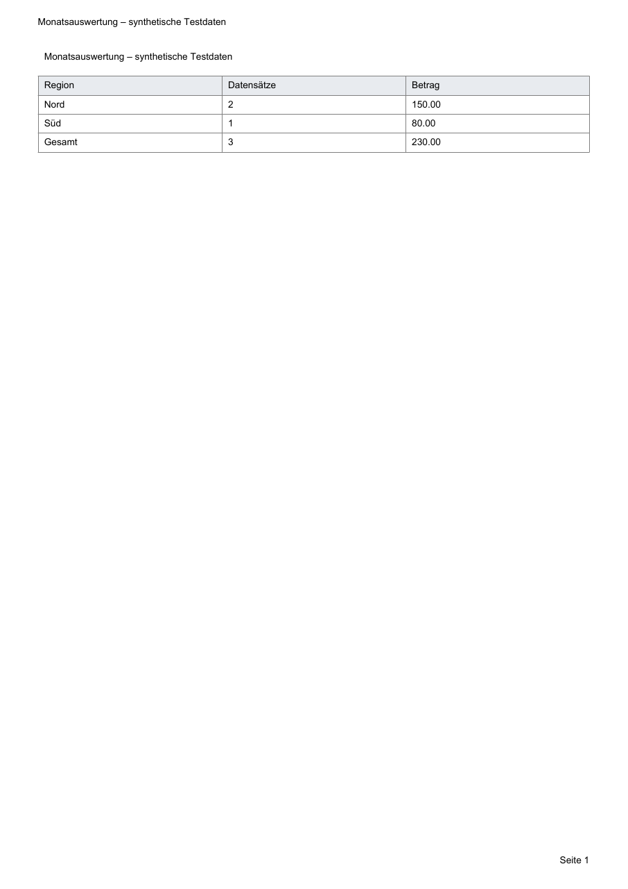

# Fachliche Beispiele und Datenlasten: tatsächlich geprüft

Stand: 26. Oktober 2026. Alle Eingaben sind synthetisch. Es wurden weder Geschäftsdaten noch Office-Anwendungen verwendet. Die Lastdateien liegen ausschließlich im ignorierten Ordner `artifacts/business-qa`; Git enthält die kleinen Beispiele und die kompakten Nachweise.

Der bereinigte [Messnachweis](nachweise/business-daten.json) enthält Originalmesswerte, Bericht-Hashes, Laufkennungen und auch die fehlgeschlagenen Versuche. Er enthält keine persönlichen Pfade oder Interpreterpfade.

## Umgebung und Messverfahren

Windows 11 Pro x64, Version 10.0.26200, Intel Core i7-13700 (16 Kerne/24 logische Prozessoren), 68.333.776.896 Byte physischer Speicher. Tatsächlich eingesetzt: CPython 3.12.6, DuckDB 2.0.0, openpyxl 3.1.5, ReportLab 5.1.0, pypdf 6.21.2 und defusedxml 0.7.1. Diese Messungen belegen keine identischen Laufzeiten auf anderen Rechnern oder eine vollständige Business-Abnahme unter sämtlichen Python-Versionen.

`scripts/business-daten-pruefen.py` startet die feste eigene Prüfroutine mit dem bereits vorhandenen Windows-Jobhelper. Der Job umfasst auch den venv-Redirector und seine Nachkommen. Kontextzeitlimit: 120 Sekunden; Jobfrist: 140 Sekunden; der Controller greift spätestens nach 150 Sekunden zusätzlich ein. Es gibt keine Shellbefehle, Paketinstallation oder allgemeinen Ausführungsweg. Quellen, Ziele und technische Dateien entstehen in einem eigenen Laufordner. Die Engine-Tests verwenden zusätzlich isolierte temporäre Verzeichnisse.

Gemessen werden:

- **Enginezeit:** ab Kontextaufbau einschließlich Import, Filter, Join, Sortierung, Export und Fachkontrollen; ohne Erzeugung der synthetischen Quelldatei.
- **Gesamtzeit:** einschließlich Erzeugung der synthetischen Quelle im Prüfprozess.
- **Peak Working Set:** Windows-Höchststand des Python-Engineprozesses über `GetProcessMemoryInfo`; einschließlich seiner Python-/Bibliotheksgrundlast. Electron, Controller und Jobhelper gehören nicht dazu.
- **Private Bytes und temporäre Dateien:** Stichproben alle 25 ms. Kurze Zwischenpeaks können zwischen Stichproben liegen. Der letzte Messstand umfasst einen privaten Prozess-TEMP mit Kontext/DuckDB/openpyxl sowie die bekannten `.scriptlab-`-Staging-Dateien im Zielordner während der Enginephase.

DuckDBs Einstellung `64MB` ist ein Pufferbudget von 64.000.000 Byte, kein gesamtes Prozess-RAM-Limit. `max_temp_bytes=2.147.483.648` begrenzt DuckDB-Spill; es ist kein Betriebssystem-Kontingent für sämtliche Bibliotheks- und Ausgabedateien. Quelldateien und fertige Ergebnisse zählen nicht zum temporären Maximum.

## Beispiel A: Monatsauswertung

[Beispielordner](../beispiele/business/A-Monatsauswertung/README.md) mit CSV, Parametern und festem Plan. Oktober 2026 berücksichtigt Nord 100, Süd 80 und Nord 50; die Septemberzeile mit 70 wird ausgeschlossen. Sowohl XLSX als auch PDF enthalten:

| Region | Datensätze | Betrag |
| --- | ---: | ---: |
| Nord | 2 | 150,00 |
| Süd | 1 | 80,00 |
| Gesamt | 3 | 230,00 |

Die Fachprüfung liest die XLSX-Datei erneut ein und prüft den tatsächlichen PDF-Text einschließlich „Süd“, „Datensätze“, Einzelbeträgen und Gesamtbetrag. Das PDF hat genau eine Seite. Die gerenderte Seite wurde außerdem visuell geprüft: keine abgeschnittenen Beschriftungen, verständliche Tabelle und lesbare Umlaute. Die lokale TrueType-Schrift ist ausschließlich Voraussetzung und wird nicht verteilt.



Die Bildprüfung ergänzt den Datenabgleich; sie ersetzt ihn nicht. Vorschau und Prüflauf wurden gesondert geprüft und erzeugen keine fachlichen Berichtsdateien. Die Quelle blieb jeweils bytegleich.

## Beispiel B: fehlende und doppelte Kundenzuordnung

[Beispielordner](../beispiele/business/B-Bestellungen/README.md): B1/K1/30, B2/K2/40, B3/K1/15 und B4/K9/5; Kunden K1/Nord und K2/Süd. Genau drei Bestellungen werden zugeordnet. Die gesonderte Fehleransicht enthält B4/K9 und der Qualitätsbericht genau einen Fehler. Die ausdrücklich auf zugeordnete Bestellungen gefilterte XLSX-Auswertung enthält Nord 45, Süd 40 und Gesamt 85. Der Gesamtlauf meldet fachliche Fehler statt eines uneingeschränkten Erfolgs.

Mit dem zweiten K1 aus `kunden-doppelt.csv` stoppt der `n:1`-Join vor dem Export. Es wird keine Kundenzeile zufällig ausgewählt und keine Bestellung vervielfacht. Die Fachtests prüfen Fehlermeldung, betroffenen Zuordnungsschritt und das Ausbleiben einer Ausgabe.

**4/4 Beispielprüfungen bestanden**, letzter vollständiger Lauf nach den Lastkorrekturen 0,969 Sekunden; keine übersprungenen Tests. Dieser Umfang gehört zu `tests/business/test_beispiele_daten.py` und umfasst A, A-Vorschau/Prüflauf, B/K9 und B/Doppel-K1.

## Million CSV-Zeilen unter 64 MB DuckDB-Budget

Der letzte bestandene Lauf verwendet 1.000.000 Eingabezeilen und fünf Spalten (216.000.044 Byte UTF-8-CSV). Ein zweiter CSV-Stamm enthält 10.000 eindeutige Kunden und zwei Spalten. Jede zweite Zeile wird ausgewählt: 500.000 Datensätze. Der `n:1`-Join prüft Eindeutigkeit und fehlende Schlüssel. **Dieses ausdrücklich schmale Profil** wählt danach Bestellung, Kunde, Region und Betrag aus. Die breite Beschreibungsspalte gehört nicht zu diesem Ergebnisschema.

Das Ergebnis wird nach Bestellung absteigend sortiert und als Parquet exportiert. Zusätzlich werden vier Regionalgruppen und der Gesamtbetrag geprüft. Jede der 500.000 exportierten Bestellkennungen wurde anschließend streamend auf Auswahl und strikt absteigende Reihenfolge geprüft. Regionalzählungen, Parquet-Zeilenanzahl, Vorschaugrenze und unveränderte Quell-Prüfsumme stimmen.

| Messung | Tatsächlicher letzter Wert |
| --- | ---: |
| Berücksichtigte Zeilen | 500.000 |
| Gesamtbetrag | 625.000,00 |
| Ergebnisgruppen | 4 |
| Enginezeit einschließlich Fachkontrollen | 4,788 s |
| Gesamtzeit einschließlich Testdatenerzeugung | 6,228 s |
| Peak Working Set des Python-Prozesses | 127.074.304 Byte |
| Größter beobachteter privater Speicher | 107.884.544 Byte |
| Größter beobachteter temporärer Gesamtstand | 72.888.320 Byte |
| Tatsächlich beobachteter DuckDB-Spill | 72.876.032 Byte |
| Parquet-Ergebnis | 526.120 Byte |

Laufkennung: `daten-ee1577e360814b1f82281477499266a0`. Parquet-SHA-256: `72f98bec5920c9a4db6eada9b9313eafe1bbe4e762aa2c55f94c00d9654658a2`. Der Spill wurde anhand realer Dateien gemessen, nicht aus einem Abfrageplan abgeleitet.

## Breites Profil: dokumentierte Speichergrenze

Vier vorherige Versuche behielten zusätzlich die breite Beschreibung und weitere Joinspalten bis zum sortierten Export. Alle verwendeten weiterhin 64 MB DuckDB-Budget und wurden mit einem Speicherfehler abgebrochen:

| Versuch | Beobachtung | Wirkung der nächsten Korrektur |
| --- | --- | --- |
| DuckDB-Standardleser, zwei Threads | 30,5-MiB-Puffer konnte bei 38,8/61,0 MiB Belegung nicht angelegt werden | Einzelner CSV-Leser mit festem 8-MiB-Puffer |
| Begrenzter CSV-Leser | Sortierexport scheiterte; 68.812.800 Byte Spill beobachtet | Ein DuckDB-Thread begrenzt gleichzeitige Arbeitsstrukturen |
| Ein Thread | Sortierexport scheiterte; 71.073.792 Byte Spill | Parquet-Zeilengruppen auf Zielgröße 8192 begrenzt |
| Zusätzlich kleinere Parquet-Zeilengruppen | Weiterhin Speicherfehler; 74.350.592 Byte Spill | Kein Erfolg für das breite 64-MB-Profil behauptet |

Der spätere erfolgreiche schmale Plan ist ein **anderes, ausdrücklich beschriebenes Ergebnisschema**. Es wurde weder heimlich das Speicherbudget erhöht noch das fehlgeschlagene breite Profil als bestanden bezeichnet. Große Sortier-/Join-Ergebnisse können trotz Spill ein größeres DuckDB-Budget oder eine gezielte Auswahl benötigter Spalten erfordern. Diese Grenze ist kein Nachweis für beliebige Millionen-Workflows.

## XLSX mit 50.000 Datenzeilen und sechs Spalten

Die synthetische XLSX enthält Kennungen mit führenden Nullen, deutsche Zeichen, Beträge, Datum, Kategorien und Text mit führendem `=`. Import: read-only, Formelbehandlung STOPP. Beträge und Datum werden ausdrücklich typisiert. Export: write-only; Formelzeichen werden als Textzellen geschrieben. Die Ausgabe wird erneut geöffnet und auf Zeilenanzahl, erste Kennung, erhaltenen Text und Gesamtsumme geprüft. Die Quelle bleibt unverändert.

| Messung | Tatsächlicher letzter Wert |
| --- | ---: |
| Eingabe-/Ausgabezeilen | jeweils 50.000 |
| Gesamtsumme | 62.500,00 |
| DuckDB-Pufferbudget | 64 MB |
| Enginezeit | 19,402 s |
| Gesamtzeit einschließlich Testdatenerzeugung | 21,835 s |
| Peak Working Set | 80.809.984 Byte |
| Größter beobachteter privater Speicher | 61.501.440 Byte |
| Temporärer Gesamtstand einschließlich openpyxl und Zielstaging | 22.508.359 Byte |
| Kontextarbeitsordner allein | 3.806.580 Byte |
| DuckDB-Spill | 0 Byte beobachtet |
| Eingabedatei / Ausgabedatei | 1.224.939 / 1.220.649 Byte |

Laufkennung: `daten-f585512c11854eb5bdcce551f780cff1`. Vor der gemeinsamen Importtransaktion benötigte ein gleich großes synthetisches Schema 104,320 Sekunden Enginezeit und 106,457 Sekunden Gesamtzeit. Nach der Transaktionskorrektur erreichte ein erster separater Wiederholungslauf 18,848/21,187 Sekunden; die letzte Messung oben umfasst zusätzlich die erweiterte Tempdateibeobachtung. Es sind eigenständige Messungen, keine garantierten Beschleunigungsfaktoren. Frühe Tempzahlen zählten nur den Kontextordner und werden nicht mit dem erweiterten Gesamt-TEMP gleichgesetzt.

## Nachvollziehbar erneut prüfen

Den fest eingerichteten, geprüften Business-Interpreter verwenden; keine fehlenden Pakete nachladen. Der native Testhost muss zuvor über den vorhandenen Buildschritt gebaut sein. Beispielbefehle, wobei `<Business-Python>` durch diesen Interpreter ersetzt wird:

```powershell
<Business-Python> -I scripts/business-daten-pruefen.py --art beispiele --zeitlimit 120
<Business-Python> -I scripts/business-daten-pruefen.py --art csv --profil schmal --zeilen 1000000 --zeitlimit 120
<Business-Python> -I scripts/business-daten-pruefen.py --art xlsx --xlsx-zeilen 50000 --zeitlimit 120
```

`--profil breit` ist die bewusst anspruchsvollere, derzeit unter 64 MB scheiternde Sortierexportprobe. Jeder Lauf erzeugt einen neuen eigenen Artefaktordner und überschreibt keine früheren Nachweise. Große Dateien gehören nicht in gewöhnliche Quellcodecommits.

Der Daten-Regressionsstand besteht zuletzt aus **49/49 im vollständigen Lauf** (2,806 s) plus **drei neuen, jeweils gezielt bestandenen Fällen**: leere Bereichsgrenzen (0,052 s, beide Grenzen geprüft), XLSX-Zellbereich mit eigener Kopfzeile und ohne Kopfzeile (0,274 s), ungültige XLSX-Bereiche mit acht Unterfällen (0,258 s). Es sind jetzt 52 definierte Datenfälle; ein erneuter vollständiger 52er-Lauf wird damit nicht vorgetäuscht. Die neue Qualitätsregel lehnt NULL-Grenzen verständlich ab, statt wegen SQL-NULL fälschlich einen gültigen Bereich zu melden. Die Bereichsauswahl verarbeitet nur die ausdrücklich gewählten Zellen; die oben gemessene leere Bereichsvorgabe bleibt unverändert.

Diese Nachweise betreffen Engine, Beispiele und Lasten. Der vollständige Editorweg, andere Python-Versionen, Installer und veröffentlichte Releases bleiben eigenständige Abnahmebereiche.
