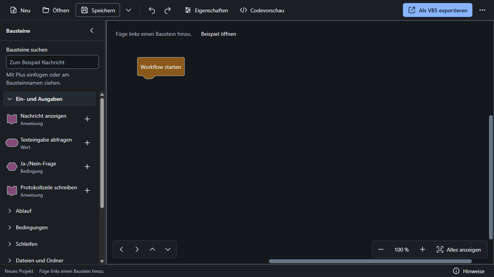
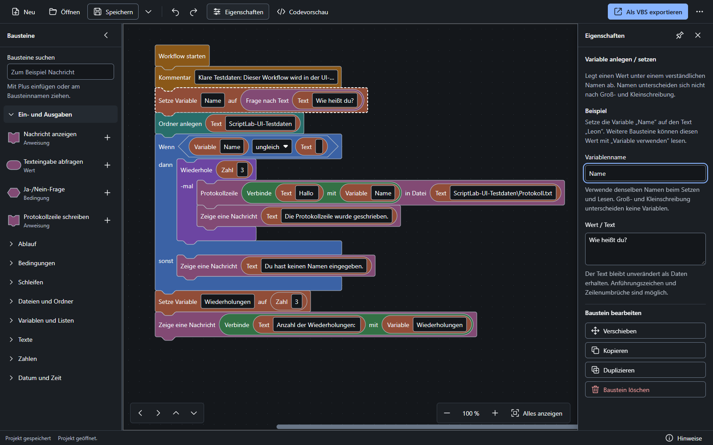
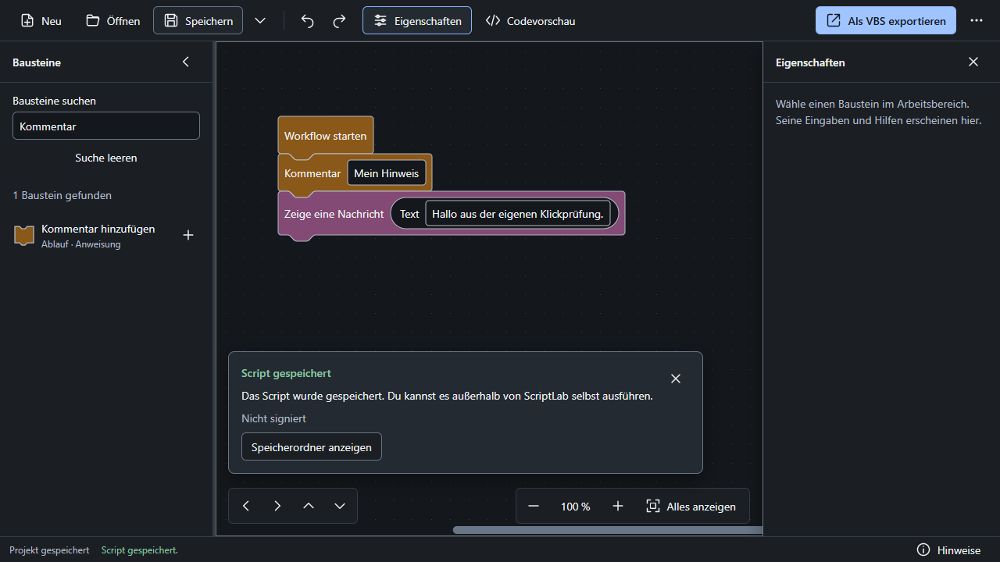

# Designnotiz zur UI-Überarbeitung

Prüfstand vom 26.10.2026. Die Oberfläche wurde in der tatsächlichen Windows-Electron-Anwendung geprüft. Die automatisierten Aufgaben wurden selbst mit Playwright durchgeführt; ergänzend fanden die unten beschriebenen nativen Windows-Prüfungen statt. Die aufgeführten Bildschirmaufnahmen wurden anschließend visuell kontrolliert. Eine externe Testperson war nicht beteiligt.

## Zweck der Änderungen

- Eine kompakte Werkzeugleiste und die standardmäßig geschlossene Codevorschau geben der Arbeitsfläche mehr Platz. Export bleibt die eine primäre Aktion.
- Kategorien und Bausteinauswahl teilen sich einen linken Bereich. Ein zusätzliches Blockly-Flyout verbraucht keine weitere Arbeitsfläche.
- Eigenschaften erscheinen unter 1440 CSS-Pixeln bewusst überlagernd; große Fenster erlauben Anheften. Ein Auswahlwechsel behält die Panelbreite bei.
- Direkt bearbeitbare Werte im Block und normal große Eigenschaftenfelder bearbeiten denselben Blockly-Zustand. Lange Pfade müssen vollständig auswählbar bleiben.
- Sichtbare Einfügestellen und eine Klickalternative ermöglichen Hinzufügen, Verbinden und Umordnen ohne gehaltene Maustaste. Die Reihenfolge folgt weiterhin den Verbindungen.
- Neutraler dunkler Hintergrund, 14-Pixel-Bedientexte und feste Abstände unterstützen die Arbeit am Ablauf. Es gibt keine dekorative Kopfinszenierung und keine erfundenen Erfolgszustände.

## Vereinbarte Tokens

| Zweck                               | Wert                                                            |
| ----------------------------------- | --------------------------------------------------------------- |
| Arbeitsfläche                       | `#14171B`                                                       |
| Grundfläche                         | `#1B1F24`                                                       |
| Erhöhte Fläche                      | `#242A31`                                                       |
| Dekorative Trennung                 | `#343C46`                                                       |
| Interaktive Kontur                  | `#697687`                                                       |
| Haupttext / Sekundärtext            | `#F1F3F5` / `#B4BDC8`                                           |
| Akzent / Text auf Akzent            | `#88B4FF` / `#121820`                                           |
| Erfolg / Hinweis / Fehler           | `#8CC8A2` / `#EBC17A` / `#F19A9A`                               |
| Schrift                             | Segoe UI Variable, Segoe UI, system-ui, sans-serif; lokal       |
| Haupttext / Metadaten / Dialogtitel | 14 / 12 / 20 CSS-Pixel                                          |
| Abstandsskala                       | 4, 8, 12, 16, 24, 32 CSS-Pixel                                  |
| Felder/Knöpfe / häufige Klickziele  | ungefähr 36 / mindestens 32 × 32 CSS-Pixel                      |
| Radien                              | 6 Pixel Felder/Knöpfe, 8 Pixel Menüs/Dialoge                    |
| Fensteraufbau                       | Toolbar 52, Palette 272, Eigenschaften 304, Status 32 CSS-Pixel |

Die tatsächliche Implementierung und Kontrastprüfung stehen unter `src/gestaltung` sowie in den zugehörigen Tests. Kategorie-Farben werden getrennt von Erfolg, Hinweis und Fehler geführt.

Die Statusleiste benötigt tatsächlich 32 CSS-Pixel statt des ursprünglichen Ziels von 28 Pixeln, damit die häufige Schaltfläche „Hinweise“ ihr Mindestklickziel behält. Bei vergrößerter UI-Schrift dürfen Werkzeug- und Statusleiste nach ihrem Inhalt wachsen.

## Praktische Ergebnisse

Der abschließende gemeinsame lokale Lauf bestand mit **47/47 Electron-Desktoptests in 58,4 Sekunden**. Zusätzlich bestanden **139/139 Unit-, Generator-, Datei- und Windows-Tests**, Typprüfung und Produktionsbuild. Die folgenden Pakete sind Teil desselben Desktop-Gesamtlaufs und werden nicht zusätzlich zu den 47 gezählt:

| Desktoppaket        | Bestandene Fälle | Schwerpunkt                                                  |
| ------------------- | ---------------- | ------------------------------------------------------------ |
| `anwendung.spec.ts` | 12/12            | Integration, Dateivorgänge, Schutzgrenze und Dialoge         |
| `eingaben.spec.ts`  | 11/11            | Eingaben, Undo, Profil-/IPC-Prüfung und eingebaute Beispiele |
| `ux.spec.ts`        | 19/19            | Größen, Bedienwege, Darstellung, Fokus und Zustände          |
| `ziehen.spec.ts`    | 5/5              | Echtes Ziehen, Einfügemarker, Escape und Verbindungen        |

Das Nachweisarchiv enthält **24 Screenshots**: 19 aus den Desktopfällen und fünf aus der echten Windows-System-DPI-Prüfung. Hinzu kommen **11 JSON-Messdateien**: sechs aus den Desktopfällen und fünf aus der Systemprüfung. Dieser UI-Abschluss belegt keinen neu gebauten Installer, keinen neuen GitHub-CI-Lauf und keine produktive Updateinstallation.

| Nachweis                          | Ergebnis und Grenze                                                                                                                                                                                                                                                               |
| --------------------------------- | --------------------------------------------------------------------------------------------------------------------------------------------------------------------------------------------------------------------------------------------------------------------------------- |
| UI-Testdaten                      | Fünf reproduzierbare `.scriptlab`-Fixtures unter `tests/ui/fixtures`; Strukturprüfung, JSON-/Blockly-Rundlauf, deterministischer Generator und Fehlerzuordnung: **4/4 Tests bestanden**. Kein Workflowinhalt ausgeführt                                                           |
| Electron-UI                       | `tests/desktop/ux.spec.ts`: **19/19 Tests bestanden**. Kleine und große Fenster, Suche, Eigenschaften, Fehler, Code, Zoom, Dateivorgänge und getrennte Zustände geprüft                                                                                                           |
| Anfangszustand                    | Genau ein Startbaustein, geöffnete Kategorie Ein-/Ausgaben, 272 Pixel gemeinsame Palette, keine zusätzliche native Flyout-Fläche, Code und Eigenschaften geschlossen                                                                                                              |
| Realistische Abläufe              | Projekt mit genau 28 Bausteinen sowie verschachtelte Schleife/Bedingung geöffnet und visuell geprüft. Codevorschau bleibt Text und ist anfangs geschlossen                                                                                                                        |
| Eigenschaften                     | Bei 1280 Pixeln Overlay ohne Änderung der Canvas-Breite; bei 1600 Pixeln anheftbar und ungefähr 304 Pixel stabil. Lange vollständige Pfade bearbeitet und Änderung im gespeicherten Blockly-Zustand nachgewiesen                                                                  |
| Vollständiger eigener Aufgabenweg | Nachricht suchen → über Plus und Zielauswahl einfügen → Text bearbeiten → Kommentar verbinden → über Klickziele umordnen → Rückgängig/Wiederholen → Projektdatei schreiben → erneut öffnen → echten unsignierten VBS-Export schreiben und UTF-16LE-BOM prüfen                     |
| Fehler und Ergebnis               | Unvollständiger Entwurf speicherbar, Export erzeugt keine VBS-Datei und zeigt konkrete Bausteinhinweise. Fehlendes gewünschtes Zertifikat erzeugt keine falsche Erfolgsmeldung. Echter unsignierter Export zeigt den Hinweis zum eigenständigen Ausführen außerhalb von ScriptLab |
| Kontrast und Fokus                | 51 tatsächlich gerenderte SVG-Textflächen des 28-Block-Projekts: mindestens **5,26:1**, 14 Pixel, keine verringerte Textdeckkraft. Bausteinauswahl bleibt bei gleichzeitig fokussiertem Eigenschaftenfeld sichtbar. [Rohdaten](../tests/ui/nachweise/svg-kontraste.json)          |
| Radbedienung und UI-Text          | Mausrad verschiebt den Canvas; Strg+Rad zoomt dort, Palettenrad ändert den Canvas-Zoom nicht. UI-Textgröße 100/125/150/200 Prozent separat geprüft; Canvas-Zoom bleibt unverändert und Export erreichbar                                                                          |
| Kontrastfarben und Bewegung       | Chromium-Medienzustände `forced-colors: active` und `prefers-reduced-motion: reduce` geprüft: Exportbeschriftung samt Kindtext, Systemfarben, sichtbare Fokuskontur und Übergangsdauer 0. Kein echter Windows-Kontrast- oder Bewegungsmodus umgestellt                            |
| Signatur- und Updateansichten     | Gültige Signatur sowie Update verfügbar/Download/Fehler als ausdrücklich gesteuerte IPC-Testantworten dargestellt. Das prüft Darstellung, keine tatsächliche Signatur oder produktive Updatekette                                                                                 |

Zusätzlich bestanden **35/35 Gestaltungstests** (`tests/gestaltung.test.ts`): Text-/Hilfs-/Statusfarben auf den drei UI-Flächen, notwendige Konturen und Fokus, Normal-/Hover-/Gedrückt-/Deaktiviert-Zustände der Hauptaktion, Kategorieflächen sowie das Markup der gemeinsamen Komponenten. Diese Farb- und DOM-Prüfungen ergänzen die Sichtprüfung; sie ersetzen sie nicht.

Das vollständige Eingabepaket bestand mit **11/11 Desktop-Regressionen**: schrittweise Palettenbreite, Zeitstempelentwürfe, fehlerhafte Eingaben und Speicherabbruch, Strg+Z/Strg+Y, sofortiges Undo, Ergänzung älterer Einstellungsprofile, ungültige IPC-Nutzdaten, die drei eingebauten Beispiele sowie eine fremde Beispiel-ID. Der frühere Viererlauf ist damit durch die vollständige Paketprüfung ergänzt.

Ein gezielter Timingtest wies vor der Korrektur nach, dass ein sofortiges Undo nach dem Einfügen noch die ältere Nachricht entfernen konnte. Zwischen Einfügeklick und Undo wird in diesem Test absichtlich nicht gewartet; der Verlauf wird zur Diagnose aufgezeichnet. Nach der Korrektur bestanden dieser Fall und der gewöhnliche Strg+Z/Strg+Y-Fall jeweils drei Wiederholungen, zusammen **6/6**. Beide sind außerdem im bestandenen 47er-Gesamtlauf enthalten. Die sechs Wiederholungen sind ein zusätzlicher Fehler-/Regressionsnachweis, keine sechs weiteren unterschiedlichen Tests und kein Beweis für jedes denkbare Ereignistiming.

Der SVG-Fokusfall wurde danach gezielt erweitert und erneut bestanden: W und Pfeil runter führen über den Arbeitsbereich zur ersten Bausteinfolge. Auf dem Variablenbaustein erreicht Pfeil rechts das bearbeitbare Namensfeld; Enter öffnet die Eingabe. Eine echte Namensänderung wurde im Projektmodell nachgewiesen und mit Strg+Z zurückgenommen. Die berechneten Blockly-CSS-Variablen sowie die tatsächlich sichtbaren aktiven Block- und Feldkonturen verwenden die vereinbarten Farben und 2 Pixel Breite. Eine zunächst vom normalen Feldrand überdeckte Fokusmarkierung wurde dabei gefunden und korrigiert. Es wurden keine Fokusklassen oder Stile durch den Test erzwungen.

Die Dialogantworten für Dateiauswahl und Speicherziel wurden kontrolliert vorgegeben. Die Anwendung hat die Projekt- und Exportdateien tatsächlich in isolierten temporären Verzeichnissen geschrieben und gelesen. Kein erzeugtes Script wurde geöffnet oder gestartet.

## Gemessene Fenster und Skalierungen

| Prozess-DPI | Tatsächlicher Rendererinhalt | `devicePixelRatio` / Electron-Displaymaßstab | Nachweis                                        |
| ----------- | ---------------------------- | -------------------------------------------- | ----------------------------------------------- |
| 100 Prozent | 1280 × 720 CSS-Pixel         | 1 / 1                                        | [Messdaten](../tests/ui/nachweise/dpi-100.json) |
| 125 Prozent | 1280 × 720 CSS-Pixel         | 1,25 / 1,25                                  | [Messdaten](../tests/ui/nachweise/dpi-125.json) |
| 150 Prozent | 1280 × 721 CSS-Pixel         | 1,5 / 1,5                                    | [Messdaten](../tests/ui/nachweise/dpi-150.json) |
| 200 Prozent | 1280 × 720 CSS-Pixel         | 2 / 2                                        | [Messdaten](../tests/ui/nachweise/dpi-200.json) |

Zusätzlich wurde 1600 × 1000 CSS-Pixel bei Prozess-DPI 100 Prozent geprüft. Die zusätzliche Zeile bei 150 Prozent entsteht durch die native Windows-Rundung von Rahmen und logischen Fenstermaßen; sie wird nicht als exakt 720 ausgegeben. Verwendet wurde je Prozess `--force-device-scale-factor`, kein Browserzoom und keine Änderung der Windows-Anzeigeeinstellungen. Die UI-Textgrößen wurden in einem eigenen Durchlauf bei 1280 × 720 CSS-Pixeln über die Anwendungseinstellung verändert. Diese Prozessprüfungen sind von der folgenden tatsächlichen Systemprüfung getrennt.

### Tatsächliche Windows-Systemskalierung

In den nativen Windows-Anzeigeeinstellungen wurde die rechte Anzeige 1 mit 3840 × 2160 physischen Pixeln von ursprünglich 175 Prozent nacheinander auf 100, 125, 150 und 200 Prozent eingestellt. Anschließend wurden die ursprünglichen 175 Prozent wiederhergestellt. Die zweite, primäre Anzeige blieb währenddessen auf 175 Prozent; Auflösung, Anordnung und andere Anzeigeeinstellungen wurden nicht geändert. Die Windows-Einstellungsanwendung wurde danach geschlossen.

Ein isoliertes Electron-Testfenster lief ohne `--force-device-scale-factor` auf dieser rechten Anzeige. Der Helper [system-dpi-pruefen.mjs](../tests/ui/system-dpi-pruefen.mjs) beobachtete den echten Displaymaßstab und den Renderer. Obwohl 1280 × 720 als Fensterinhalt angefordert und begrenzt nachkorrigiert wurde, lieferte die native Fensterrahmenberechnung im Betrieb mit unterschiedlichen Anzeige-Skalierungen die folgenden tatsächlichen Werte. Sie werden unverändert berichtet.

| Windows-Skalierung             | Tatsächlicher Rendererinhalt in CSS-Pixeln | Nutzbare Anzeige ohne Taskleiste in logischen Pixeln | `devicePixelRatio` / Electron-Displaymaßstab | Messdaten und App-Aufnahme                                                                     |
| ------------------------------ | ------------------------------------------ | ---------------------------------------------------- | -------------------------------------------- | ---------------------------------------------------------------------------------------------- |
| 100 Prozent                    | 1288 × 745                                 | 3840 × 2112                                          | 1 / 1                                        | [JSON](../tests/ui/nachweise/windows-100.json), [PNG](../tests/ui/screenshots/windows-100.png) |
| 125 Prozent                    | 1286 × 735                                 | 3072 × 1680                                          | 1,25 / 1,25                                  | [JSON](../tests/ui/nachweise/windows-125.json), [PNG](../tests/ui/screenshots/windows-125.png) |
| 150 Prozent                    | 1282 × 726                                 | 2560 × 1392                                          | 1,5 / 1,5                                    | [JSON](../tests/ui/nachweise/windows-150.json), [PNG](../tests/ui/screenshots/windows-150.png) |
| 200 Prozent                    | 1279 × 717                                 | 1920 × 1032                                          | 2 / 2                                        | [JSON](../tests/ui/nachweise/windows-200.json), [PNG](../tests/ui/screenshots/windows-200.png) |
| 175 Prozent, wiederhergestellt | 1280 × 721                                 | 2195 × 1187                                          | 1,75 / 1,75                                  | [JSON](../tests/ui/nachweise/windows-175.json), [PNG](../tests/ui/screenshots/windows-175.png) |

Alle fünf App-Aufnahmen wurden unabhängig visuell geprüft. Werkzeugbeschriftungen, Export, Palette, Startbaustein, Ansichtsknöpfe und Status blieben sichtbar. Die dokumentierten Breiten/Höhen des HTML-Dokuments entsprechen jeweils dem Rendererinhalt; es entstand keine zusätzliche äußere Seitenscrollfläche. Diese native Prüfung umfasst den Anfangszustand mit Startbaustein. Der vollständige Klickweg mit Speichern, Öffnen und Export wurde separat geprüft und nicht an jeder Windows-Skalierungsstufe erneut durchgeführt. Kein Workflow wurde ausgeführt. Archiviert wurden ausschließlich ScriptLab-Rendereraufnahmen und Messwerte, keine Windows-Einstellungsansichten.

## Überprüfte Bildschirmaufnahmen

Die Aufnahmen unter `tests/ui/screenshots` dokumentieren die ausgeführten Fälle, keine separate Oberflächendemo.

| Zustand                                                                                                 | Aufnahme                                                                                                                                                                                                  |
| ------------------------------------------------------------------------------------------------------- | --------------------------------------------------------------------------------------------------------------------------------------------------------------------------------------------------------- |
| 28 Bausteine, großes Fenster                                                                            | [Workflow](../tests/ui/screenshots/workflow-28-bausteine.png)                                                                                                                                             |
| Verschachtelte Schleife/Bedingung mit optionaler Codevorschau                                           | [Codepanel](../tests/ui/screenshots/verschachtelt-mit-code.png)                                                                                                                                           |
| Lange Pfade, schmaler Eigenschaftenbereich, internes Scrollen                                           | [Overlay](../tests/ui/screenshots/eigenschaften-overlay-lange-pfade.png)                                                                                                                                  |
| Anheftbare Eigenschaften bei 1600 Pixeln                                                                | [Angeheftet](../tests/ui/screenshots/eigenschaften-angeheftet-1600.png)                                                                                                                                   |
| Fehlende Pflichtwerte und loser aktiver Baustein                                                        | [Fehlerübersicht](../tests/ui/screenshots/fehler-am-baustein.png)                                                                                                                                         |
| Kategorieübergreifende Suche und eigener Leerzustand                                                    | [Treffer](../tests/ui/screenshots/suche-treffer.png), [keine Treffer](../tests/ui/screenshots/suche-ohne-treffer.png)                                                                                     |
| Gewünschte Signatur ohne Zertifikat, tatsächlicher Konfigurationsfehler                                 | [Signatur fehlt](../tests/ui/screenshots/signatur-nicht-eingerichtet.png)                                                                                                                                 |
| Gültige Signatur, ausschließlich gesteuerte UI-Testantwort                                              | [Testantwort](../tests/ui/screenshots/testantwort-signatur-gueltig.png)                                                                                                                                   |
| Update verfügbar/Download/Fehler, ausschließlich gesteuerte UI-Testantworten; Prozentwert ist Testdatum | [Verfügbar](../tests/ui/screenshots/testantwort-update-verfuegbar.png), [Download](../tests/ui/screenshots/testantwort-update-laedt.png), [Fehler](../tests/ui/screenshots/testantwort-update-fehler.png) |
| UI-Text 200 Prozent; normale Blockgröße und umbrochene Werkzeugleiste                                   | [Größere Schrift](../tests/ui/screenshots/ui-text-200.png)                                                                                                                                                |
| Emulierte Kontrastfarben und reduzierte Bewegung                                                        | [Medienzustände](../tests/ui/screenshots/simulierte-kontrastfarben-reduzierte-bewegung.png)                                                                                                               |

Bei der Sichtprüfung wurden unter anderem unsichtbarer Kindtext im Kontrastmodus, ausgeblendete Werkzeugbeschriftungen bei großer UI-Schrift und vom Eigenschaftenoverlay verdeckte Zoomknöpfe gefunden, korrigiert und erneut geprüft. Die aktuelle Aufnahme zeigt jeweils den korrigierten Zustand.

## Begrenzte native Prüfung mit Windows-Sprachausgabe

Die vorhandene Windows-Sprachausgabe (`Narrator.exe`) wurde tatsächlich geöffnet, ihr Starthinweis geschlossen und ihre Startseite minimiert. In ScriptLab zeigte Tab auf „Neu“ und anschließend Feststelltaste + Pfeil rechts auf „Öffnen“ die blaue Fokusmarkierung der Sprachausgabe.

Über die Windows-UI-Automation wurden „Nachricht anzeigen“ mit Plus und danach „Nach Workflow starten“ gewählt. F4 öffnete die Eigenschaften. Das Textfeld „Hallo“ wurde um „Prüfung mit Windows-Sprachausgabe“ ergänzt; derselbe Wert erschien unmittelbar im Baustein und im Eigenschaftenfeld. Die grau gestrichelte Bausteinauswahl und der Fokus im Textfeld waren unterscheidbar. Im deutschen UI-Automation-Baum waren die Navigation „Projektaktionen“, benannte Schaltflächen, Palette, Suche, Start- und Nachrichtenanweisung, Textwert, Texteingabe sowie Status enthalten.

Diese Prüfung ist begrenzt: Es wurde keine Audioausgabe aufgenommen oder abgehört. Die UI-Automation meldete als fokussiertes Element teilweise weiterhin Dokument beziehungsweise Fenster, obwohl die Aufnahme eine sichtbare Fokusmarkierung zeigte. Ein vollständiger Sprachausgabe-Abnahmelauf bleibt deshalb offen; aus der sichtbaren Markierung wird keine korrekte Ansage aller Inhalte abgeleitet.

Die Sprachausgabe wurde mit Feststelltaste + Escape beendet; anschließend war ihr Prozess nicht mehr vorhanden. Auch ScriptLab mit seinem isolierten Testprofil wurde beendet. Kein Workflow wurde ausgeführt. Der Renderer-Prozess verwendete laut Kommandozeile den Skalierungsfaktor 1,75; genaue CSS-Inhaltsmaße wurden bei dieser nativen Prüfung nicht erfasst. Sie zählt daher nicht zur DPI-Abnahme. Aus diesem Durchlauf wurden keine zusätzlichen Bildschirmaufnahmen archiviert.

## Konkrete offene Punkte

Ein externer Verständlichkeitstest mit einer Person ohne Programmierkenntnisse, ein vollständiger Windows-Screenreader-Durchlauf mit geprüfter Audioausgabe sowie ein echter Wechsel des Windows-Kontrastmodus bleiben offen. Die begrenzte native Sprachausgabe-Prüfung oben ersetzt diese vollständige Abnahme nicht. Die Windows-Systemskalierung wurde dagegen wie oben dokumentiert tatsächlich verändert, gemessen und wiederhergestellt. Die Messung der 51 SVG-Textflächen deckt die tatsächlich verwendeten Flächen dieses Testprojekts ab, nicht jede mögliche Oberfläche oder jede Betriebssystemfarbkombination. Eine allgemeine Barrierefreiheitskonformität wird nicht behauptet.

Signaturgültigkeit und Updateinstallation müssen weiterhin anhand ihrer eigenständigen technischen Nachweise bewertet werden. Gesteuerte Darstellungsantworten dürfen weder als vertrauenswürdige Nutzersignatur noch als erfolgreich installierte zweite Releaseversion gezählt werden. Ziehen, Escape und Tastaturnavigation haben gesonderte Regressionstests; deren Ergebnisse sind nicht Teil der hier genannten 19 UX-Tests.

Die Prüfgrundlagen und ihre Grenzen sind in [UI-PRUEFPLAN.md](UI-PRUEFPLAN.md) mit den Originalquellen verlinkt. Die ältere technische Produktabnahme in [ABNAHME.md](ABNAHME.md) ersetzt diese zusätzliche UI-Abnahme nicht.

Der UI-Commit `d348836` bestand zusätzlich den unabhängigen [GitHub-Windows-Lauf](https://github.com/siggismalz/ScriptLab/actions/runs/40318064995) einschließlich NSIS-Bau. Ein aktueller lokaler Testinstaller wurde ebenfalls gebaut und mit zehn lesenden Paketprüfungen kontrolliert. Der tatsächliche Bericht liegt unter `release/pruefung.json`; Installer und Anwendung sind unsigniert. Diese Nachweise sind weder eine Installation noch eine produktive Updateprüfung.
