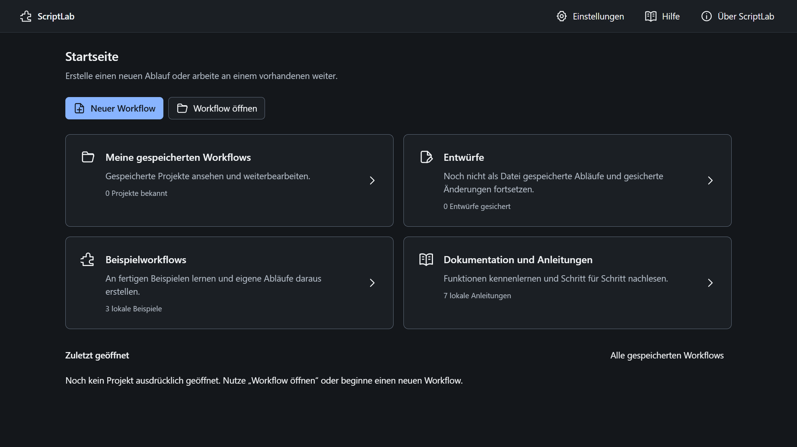

# Startseite und lokale Workflowbibliothek

## Aktuelle Navigation und Ablage

**Start** bietet die vier Einstiege **Meine gespeicherten Workflows**, **Entwürfe**, **Beispielworkflows** und **Dokumentation und Anleitungen** sowie zuletzt geöffnete Workflows. **Neuer Workflow** führt zur Sprachwahl. **Weiterbearbeiten** kehrt zum aktiven Workflow zurück. Im Editor führt **Bereiche** zu Start, Workflows, Vorlagen, Hilfe und Einstellungen; **Ablauf**, **Daten und Parameter** und **Läufe** bearbeiten weiterhin denselben Workflow.

**Speichern** sichert ohne Zielauswahl unter `Workflows\<Projektkennung>.scriptlab` im ScriptLab-Nutzerverzeichnis. Extern geöffnete Projekte werden beim Speichern intern übernommen; die externe Quelldatei wird nicht ersetzt. **Workflow → Kopie anlegen** erzeugt eine unabhängige interne Kopie mit neuer Kennung. Auch **Als Projekt speichern** in der Entwurfsliste benötigt keine Zielauswahl. Für eine weiterzugebende `.scriptlab`-Datei verwendest du **Exportieren**.

Die Workflowliste bleibt eine Liste bekannter Dateien, kein Laufwerkscan. Suche, Sprachfilter und Sortierung gelten für diese Liste. Beispielworkflows werden als unabhängige Kopien geöffnet; mitgelieferte Business-Testdateien liegen im Arbeitsordner der Kopie. Ansichtswechsel starten keinen Workflow und verwerfen keine Änderungen. Entwürfe bleiben gesonderte lokale Zwischenstände.

Laufhistorien stehen unter **Läufe** des geöffneten Workflows. **Alle Läufe** führt zur Liste; **Anzeigen** öffnet die Details eines konkreten Laufs. Die aktuelle Bedienung und die Ablagegrenzen stehen in [BEDIENUNG.md](BEDIENUNG.md) und [WEITERENTWICKLUNG.md](WEITERENTWICKLUNG.md). Für die jetzigen Farben und Flächen gelten das [Designsystem](gestaltung/DESIGNSYSTEM.md) und die [Informationsebenen](gestaltung/INFORMATIONSEBENEN.md).

## Historischer Einführungs- und Prüfstand

Die folgenden Farben, Anordnungen und Prüfergebnisse beschreiben die frühere Einführung. Sie bleiben als historische Nachweise erhalten und belegen keine Abnahme der späteren Oberfläche oder Ablage.

Die anschließende Python-Erweiterung ergänzt dieselbe Startseite um die ausdrückliche Sprachauswahl bei Neuanlage, Sprachkennzeichnungen und sechs Vorlagen mit Sprachfilter. Ihre aktuellen Nachweise stehen in [PYTHON.md](PYTHON.md); die unten dokumentierten früheren Prüfungen bleiben ihrem damaligen Umfang zugeordnet.

Historischer Prüfstand vom 26.10.2026, vor Einführung der bewussten Workflowtests. Die Startseite ist in das bestehende ScriptLab integriert. Der Editor und sein VBS-Export bleiben Bestandteil derselben Anwendung; während der hier dokumentierten Startseitenprüfung wurde kein Nutzerworkflow ausgeführt. Die spätere Funktion **Testen** und ihre eigenen Nachweise stehen in [TESTLAUF.md](TESTLAUF.md).

## Bestandsaufnahme und Entscheidungen

Die bisherige App öffnete sofort einen unbenannten Startbaustein. Für den neuen Einstieg kommen vier klar beschriftete Bereiche hinzu: gespeicherte Workflows, lokale Entwürfe, unveränderte Beispielvorlagen und offline ausgelieferte Anleitungen. Gespeicherte Projekte werden anhand konkreter, vom Nutzer gewählter Dateien geführt. Es wird kein Laufwerk nach Projekten durchsucht.

Der Editor bleibt beim Wechsel zur Startseite erhalten. „Weiterbearbeiten“ kehrt zum gleichen Arbeitsstand mit Kennung, Bausteinen, Auswahl und sichtbarem Ausschnitt zurück. Die Startseite führt keinen Export und keine Dateiaktion eines Workflows aus.

Ein Entwurf ist eine gesonderte Wiederherstellungskopie im Benutzerprofil. Er ist kein automatisches Speichern in die ursprüngliche `.scriptlab`-Datei. Inhaltliche Änderungen werden zeitversetzt gesichert; neue leere Projekte und reine Ansichtsänderungen erzeugen keinen zusätzlichen Entwurf. Wiederherstellungen werden bewusst ausgewählt. Neue Workflows und Beispielkopien erhalten eigene UUIDs; Vorlagendateien bleiben unverändert.

## Gestaltung und gemeinsame Komponenten

Die Startseite nutzt dieselben Tokens aus `src/gestaltung/tokens.ts` und dieselben Knöpfe, Felder, Symbole und Statusanzeigen wie der Editor. Die [Tokentabelle der Designnotiz](DESIGNNOTIZ.md#vereinbarte-tokens) gilt unverändert: Graphitflächen `#14171B`, `#1B1F24` und `#242A31`, Haupttext `#F1F3F5`, Sekundärtext `#B4BDC8`, erkennbare Konturen `#697687` und Akzent `#88B4FF`. Segoe, Abstände von 4 bis 32 Pixeln, 6-/8-Pixel-Radien und die vorhandene Fokuskontur bleiben gemeinsam definiert.

Der Inhalt ist auf 1120 CSS-Pixel begrenzt und erhält 24 Pixel Innenabstand. Neutrale Karten stehen mit 16 Pixel Abstand in zwei Spalten; unter 900 Pixeln wird daraus eine Spalte. Mindesthöhen ordnen das Raster, ohne vergrößerten Text abzuschneiden. Jede Karte ist genau ein beschrifteter Navigationsknopf. Der gefüllte Knopf „Neuer Workflow“ benennt die wichtigste erste Aufgabe. Die Inhaltsseite scrollt, während die gemeinsame Navigation erreichbar bleibt. Editorpalette, Export und Canvas-Zoom erscheinen erst im Editor.

## Praktischer Prüfnachweis

Der abschließende gemeinsame Lauf bestand mit **72/72 echten Electron-Desktoptests in 120,8 Sekunden**, ohne übersprungene oder wiederholte Fälle. Dazu bestanden **159/159 Kern-, Generator-, Datei-, Dienst- und Komponententests**, Typprüfung und Produktionsbuild. Der Desktopbericht liegt lokal unter `artifacts/desktop-ergebnis.json`; die ausführbaren Prüffälle sind eingecheckt.

| Desktoppaket                                                                                      | Ergebnis |
| ------------------------------------------------------------------------------------------------- | -------- |
| Vollständige Integration (`anwendung.spec.ts`)                                                    | 12/12    |
| Schutz bei Schreib-I/O und verschachtelten Speicherentscheidungen (`arbeitsstand-schutz.spec.ts`) | 4/4      |
| Eingaben, IPC und Beispiele (`eingaben.spec.ts`)                                                  | 11/11    |
| Startseite, Ablage, Wiederherstellung, Hilfe und Darstellung (`startseite.spec.ts`)               | 21/21    |
| Bestehende Editor- und UX-Fälle (`ux.spec.ts`)                                                    | 19/19    |
| Echtes Ziehen und Escape (`ziehen.spec.ts`)                                                       | 5/5      |

Die bestehenden Editorpakete wurden auf den neuen Einstieg und das vollständige Ende asynchroner Dateivorgänge angepasst und gemeinsam erneut ausgeführt. Dialogtests warten auf die tatsächlich angefragte native Entscheidung, bevor sie eine weitere Antwort einstellen. Der Verlustdialog besitzt „Speichern“, „Als Entwurf behalten“, „Änderungen verwerfen“ und „Abbrechen“; die strenge Prüfung dieser vier Aktionen bleibt erhalten.

Der erste Aufgabenweg führt über „Neuer Workflow“ → Nachricht über Plus und Zielwahl einfügen → Baustein auswählen und zoomen → Startseite → Weiterbearbeiten. Projektkennung, vollständiger Editorzustand, Ansicht und Auswahl bleiben identisch. Der erste Editorwechsel setzt den sichtbaren Fokus auf die Bausteinsuche; ein fehlgeschlagenes Dateiöffnen kann quittiert werden und lässt den Arbeitsstand erhalten.

## Bestandene Startseitenfälle

| Bereich                              | Tatsächlich geprüfter Weg                                                                                 | Nachgewiesene Grenze                                                                  |
| ------------------------------------ | --------------------------------------------------------------------------------------------------------- | ------------------------------------------------------------------------------------- |
| Erststart                            | Vier Bereichskarten, leere eigene Projekte und Entwürfe, klarer Neuer-Workflow-Einstieg                   | Beispiele erscheinen nicht als eigene Projekte                                        |
| Gespeicherte Projekte                | Speichern, erneut öffnen, Liste und zuletzt geöffnet, doppelte Öffnung, Suche und Namenssortierung        | Reale Dateien und bekannte Pfade; keine erfundenen Einträge                           |
| Fehlende Datei                       | Testdatei im isolierten Verzeichnis verschieben, Verfügbarkeit anzeigen, neu zuordnen                     | Bearbeitungsstand bleibt erhalten, kein Datenverlust                                  |
| Fehlerhafte Datei                    | Ungültiges JSON öffnen                                                                                    | Aktives Projekt und kaputte Quelldatei bleiben unverändert                            |
| Entwurf nach Abbruch                 | Inhalt bearbeiten, echte verzögerte Sicherung abwarten, isolierten Mainprozess beenden, Profil neu öffnen | Keine automatische Wiederherstellung, bewusstes Fortsetzen; Originaldatei unverändert |
| Verwerfen                            | Inhalt ändern und ausdrücklich verwerfen, nach Timerfrist neu starten                                     | Verworfener Stand wird nicht nachträglich erneut gesichert                            |
| Speichern fehlgeschlagen/abgebrochen | Echtes Speicherdialogziel abbrechen oder als Verzeichnis belegen                                          | Arbeitsstand und vorhandener Entwurf bleiben erhalten                                 |
| Vorlagen                             | Jede Vorlage als Kopie öffnen und bearbeiten                                                              | Neue Kennung, Kopiename, Vorlagendatei bytegleich                                     |
| Offlinehilfe                         | Sieben Themen, Suche, interner Beispielverweis                                                            | Lokale Inhalte; kein Netzwerk erforderlich                                            |
| Kleine Flächen und Fokus             | 1280 × 720 sowie einspaltiger Aufbau bei ungefähr 850 Pixeln; große UI-Schrift und Tastatur               | Hauptaktionen erreichbar, sichtbarer Fokus, keine äußere Überbreite                   |

Dialogantworten werden für reproduzierbare Dateiziele kontrolliert vorgegeben. Projektdateien, Index und Entwurfsdateien müssen tatsächlich geschrieben und erneut gelesen werden. Eine gesteuerte Erfolgsmeldung allein gilt nicht als Nachweis. UI-Läufe werden wegen des gemeinsamen Windows-Fokus nacheinander ausgeführt.

Die Crashprüfung bricht ausschließlich den eigenen isolierten Windows-Testprozessbaum ab und startet dieselbe Anwendung mit demselben temporären Profil erneut. Der Entwurf wird dabei nicht über eine Beenden-Funktion nachträglich gesichert. Die verzögerte Sicherung wurde vorher tatsächlich abgewartet und in der Bibliothek nachgewiesen. Nach Neustart erscheint ein sachlicher Entwurfshinweis; erst „Fortsetzen“ übernimmt den ausgewählten Inhalt. Draft-ID und Projektkennung werden getrennt geprüft. Die Ausgangsdatei bleibt bytegleich.

Bei beiden Verwerfen-Fällen wurde zusätzlich länger als die 1200-ms-Sicherungsfrist gewartet und dann neu gestartet: Weder ein ausstehender Timer noch ein bereits gespeicherter Entwurf durfte den ausdrücklich verworfenen Stand zurückbringen. Ein abgebrochener Speicherdialog und ein reales, als Ordner belegtes Dateiziel ließen den Arbeitsstand und seinen Entwurf erhalten. „Als Projekt speichern“ erzeugt aus dem Entwurf eine eigenständige Projektkopie; „Entwurf löschen“ benötigt eine ausdrückliche Bestätigung und lässt die Projektdatei erhalten.

Der Testlauf fand einen tatsächlich veralteten Verfügbarkeitsstatus nach externer Dateiverschiebung. Die Rückkehr zur Startseite invalidiert den Cache jetzt; die fehlende Datei wurde anschließend korrekt gemeldet und erfolgreich neu zugeordnet. Die Dateiprüfung bleibt vom schnellen Indexlesen getrennt.

Zusätzliche Schutzfälle prüfen eine vor dem Öffnen angelegte Konfliktkopie mit anschließender abgebrochener Entwurfsspeicherung sowie echtes verzögertes Schreiben. Während dieser Datei-I/O bleiben Eigenschaften, Blockly und verändernde Tastenkürzel gesperrt. Das erneute Öffnen derselben Datei nach „Speichern“ lädt den gerade geschriebenen Stand, sowohl über den Dateidialog als auch über die Projektbibliothek. Ausgangsdatei, neue Kennung, Index und sichtbare Werte werden unabhängig verglichen.

Der damalige Quellcode- und IPC-Review bestätigte die Grenze gegen automatische Ausführung: Die neuen Dateieinstiege akzeptieren bekannte Kennungen und geprüfte Projekte. Es gibt keine allgemeine Datei-, Shell- oder Prozessschnittstelle. Die beiden Exploreraufrufe zeigen ausschließlich Speicherorte an; der feste Signaturprozess bleibt davon getrennt. Vorschau, Vorlagen, Wiederherstellung und Export starten auch nach Einführung des gesonderten Testhosts keine Nutzerworkflows.

Ein vor dem Programmstart angelegter Index mit unbekanntem Schema 2 wird nicht als leerer Bestand ausgegeben. Die Startseite zeigt eine Warnung und „Bestand nicht vollständig geladen“. Die ursprünglichen Indexbytes bleiben unverändert; eine unabhängig gewählte gültige `.scriptlab`-Datei ließ sich trotzdem öffnen, ohne Index oder Projektdatei umzuschreiben.

Die ergänzende Sichtprüfung deckte außerdem eine echte Ansichtsverschiebung beim Laden des noch unsichtbaren Blockly-Editors auf. Sie wurde behoben: Vor dem Laden wird der sichtbare Arbeitsbereich ausgemessen; die ursprüngliche neue Ansicht bleibt bei 0,0 und der Startbaustein erscheint an seiner Modellposition 80,96. Rasteroffset 0,0 und 24-Pixel-Raster wurden am tatsächlichen SVG nachgewiesen. Neu- und Wiederherstellungsaufnahmen wurden nach Ende des Dateivorgangs und zwei Animationsframes erneut geprüft. Die frühere Überlagerung am Canvasrand ist korrigiert. Die Tests rufen dafür keine Zentrierung oder automatische Einpassung auf.

## Gemessene Flächen und Bildschirmaufnahmen

Die Fenster wurden ohne Browserzoom auf 1280 × 720 beziehungsweise 850 × 720 angefordert. Bei der vorhandenen Windows-Skalierung lieferte die native Rahmenberechnung tatsächlich **1282 × 721** und **851 × 721 CSS-Pixel**, jeweils `devicePixelRatio` **1,75**. Die Tests protokollieren diese Werte und lassen höchstens zwei Pixel Breitenabweichung zu. Bei der schmalen Fläche wurde eine Spalte, bei der breiten Fläche zwei Spalten nachgewiesen. UI-Textgröße 200 Prozent, interner Bildlauf, sichtbarer Kartenfokus, Tab/Enter-Navigation und Fokusrückgabe nach dem Einstellungsdialog wurden getrennt vom Canvas-Zoom geprüft.

Zusätzlich wurde die neue Startseite in vier getrennten Electron-Prozessen mit `--force-device-scale-factor` geprüft. Das sind **prozessweise Darstellungsprüfungen**, keine Änderungen der Windows-Anzeigeeinstellungen. Sie werden nicht mit der früheren tatsächlichen Windows-DPI-Prüfung des Editors gleichgesetzt. Alle vier Kartennamen waren vollständig sichtbar, Hauptaktionen mindestens 32 × 32 CSS-Pixel groß, der Text lesbar und das HTML-Dokument ohne horizontale Überbreite.

| Prozessfaktor | Tatsächlicher Rendererinhalt | DPR / Electron-Displaymaßstab | Messdaten und Startseitenaufnahme                                                                                            |
| ------------- | ---------------------------- | ----------------------------- | ---------------------------------------------------------------------------------------------------------------------------- |
| 100 Prozent   | 1280 × 720 CSS-Pixel         | 1 / 1                         | [JSON](../tests/ui/nachweise/startseite-prozess-dpi-100.json), [PNG](../tests/ui/screenshots/startseite-prozess-dpi-100.png) |
| 125 Prozent   | 1282 × 722 CSS-Pixel         | 1,25 / 1,25                   | [JSON](../tests/ui/nachweise/startseite-prozess-dpi-125.json), [PNG](../tests/ui/screenshots/startseite-prozess-dpi-125.png) |
| 150 Prozent   | 1280 × 721 CSS-Pixel         | 1,5 / 1,5                     | [JSON](../tests/ui/nachweise/startseite-prozess-dpi-150.json), [PNG](../tests/ui/screenshots/startseite-prozess-dpi-150.png) |
| 200 Prozent   | 1280 × 720 CSS-Pixel         | 2 / 2                         | [JSON](../tests/ui/nachweise/startseite-prozess-dpi-200.json), [PNG](../tests/ui/screenshots/startseite-prozess-dpi-200.png) |

Angefordert waren jeweils 1280 × 720 CSS-Pixel. Die maximal zwei Pixel Abweichung durch native Rundung werden als Istwerte berichtet. Der [native Beobachtungshelper](../tests/ui/system-dpi-pruefen.mjs) wartet für zukünftige manuelle Systemprüfungen nun auf die Startseite; er wurde für diese Prozessprüfungen nicht gestartet.

| Zustand                                                           | Nachweis                                                                                                                                                 |
| ----------------------------------------------------------------- | -------------------------------------------------------------------------------------------------------------------------------------------------------- |
| Gespeicherte Projekte und tatsächlich zuletzt geöffnet            | [Aufnahme](../tests/ui/screenshots/startseite-zuletzt-geoeffnet.png)                                                                                     |
| Ungültige Projektdatei bei erhaltenem Arbeitsstand                | [Aufnahme](../tests/ui/screenshots/startseite-fehlerhafte-projektdatei.png)                                                                              |
| Nach Schreibfehler und Neustart erhaltener Entwurf                | [Aufnahme](../tests/ui/screenshots/startseite-entwurf-nach-schreibfehler-erhalten.png)                                                                   |
| Bewusst fortgesetzter Entwurf mit unverändertem Arbeitsausschnitt | [Aufnahme](../tests/ui/screenshots/startseite-entwurf-bewusst-fortgesetzt.png)                                                                           |
| Neues Projekt mit korrekter Modellposition und Raster             | [Aufnahme](../tests/ui/screenshots/startseite-neuer-editor-stabil.png), [Geometriemessung](../tests/ui/nachweise/startseite-neuer-editor-geometrie.json) |
| Lokale Hilfe samt echtem Vorlagenlink                             | [Aufnahme](../tests/ui/screenshots/startseite-offline-hilfe.png)                                                                                         |
| Zwei Spalten und UI-Text 200 Prozent                              | [Aufnahme](../tests/ui/screenshots/startseite-karten-1280-text-200.png), [Messdaten](../tests/ui/nachweise/startseite-fenster-1280.json)                 |
| Eine Spalte und UI-Text 200 Prozent                               | [Aufnahme](../tests/ui/screenshots/startseite-karten-850-text-200.png), [Messdaten](../tests/ui/nachweise/startseite-fenster-850.json)                   |

Die [Aufnahme des unbekannten Indexschemas](../tests/ui/screenshots/startseite-indexschema-unbekannt.png) dokumentiert die sichtbare Warnung und die fehlende falsche Nullangabe.

Diese 14 Rendereraufnahmen wurden visuell geprüft. Es handelt sich um die tatsächliche Anwendung mit isolierten Testdaten, nicht um eine separate Demo oder erfundene Erfolgsansichten.

## Offene Prüfgrenzen

Ein externer Verständlichkeitstest, eine vollständige Sprachausgabeprüfung mit abgehörter Audioausgabe und ein echter Windows-Kontrastmodus sind durch diese Tests nicht ersetzt. Die neue Startseite wurde bei der vorhandenen Windows-Skalierung von 175 Prozent sowie den getrennt ausgewiesenen Prozessfaktoren geprüft; ein erneuter nativer Systemwechsel durch sämtliche Stufen fand für diese Erweiterung nicht statt. Frühere DPI-Messungen bleiben ihrem dokumentierten Editor-Prüfstand zugeordnet.

Paketbau und GitHub-CI sind getrennte Nachweise. `npm run package` und `npm run verify:package` erzeugen einen lokalen Testinstaller mit dem Bericht `release/pruefung.json`; er nennt den tatsächlich geprüften Git-Stand, Dateihashes, Paketvergleiche und Grenzen. Die Desktoptests allein belegen keine Installation, Veröffentlichung oder produktive Updateinstallation. Entwicklersignatur, vertrauenswürdiger Nutzerzertifikat-Export mit Zeitstempel und eine echte Updatekette zwischen zwei installierbaren Versionen bleiben den Einrichtungsschritten aus [ABNAHME.md](ABNAHME.md) zugeordnet.
