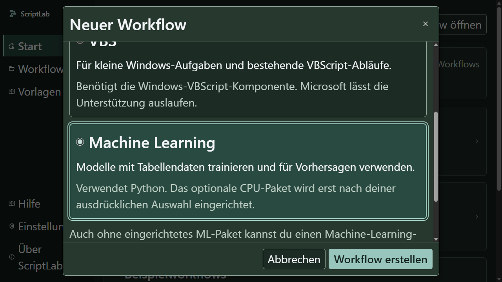

# Machine Learning: Integration und Abnahme

## Stand und Arbeitsteilung

ML-Ausgang: sauberer Branch `main` bei `8496feb`, Remote `origin` → `siggismalz/ScriptLab`. Windows 11 x64 Build 26200, Node 24.19.0, npm 11.17, CPython 3.15.2, Electron 45.0.0, Blockly 13.4.0, React 19.3.1. Keine fremden Änderungen wurden verworfen. Diese Prüfung erfasst den bestätigten ML-Plan, keine vollständige Prüfung jeder Codezeile oder Kombination.

Die drei tatsächlich gestarteten Fachagenten bearbeiteten getrennte Schreibbereiche: **Businessdaten** implementierte Training, Vorverarbeitung, Modellformat und Pythonregressionen; **Ausführung** das isolierte CPU-Profil, Einrichtung und Windows-Laufzeitprüfungen; **Bedienung** Karten, Palette, Ergebnisansicht, UI-Prüfungen und Anleitung. Root verantwortete Projektformat, Main/Preload/IPC, Integration, Export, Vorlagen, Gesamtprüfungen, Git und Paketierung. Kritische Herkunfts-/Journal- und Prozessänderungen wurden zusätzlich unabhängig lesend und mit einer tatsächlichen Gegenprobe geprüft.

Die [konkreten Aufträge und Verträge](ML-PLAN.md), [Laufzeitnachweise](ML-LAUFZEIT.md), [Backendprüfungen](ML-VERARBEITUNG.md), [UI-Abnahme](ML-BEDIENUNG.md) und [Integrationsreview](ML-REVIEW-INTEGRATION.md) enthalten die jeweiligen Nachweisgrenzen. Frühere Berichte bleiben historische Nachweise.

## Sichtbares Ergebnis und Architekturentscheidungen

- Dritte Erstellungskarte **Machine Learning**, derselbe echte Blockly-Editor, fachlich begrenzte Palette und vier Modellaktionen: trainieren, speichern, laden, vorhersagen. Allgemeines Python und VBS behalten ihren Katalog. Keine neue UI-Komplettbibliothek; vorhandene Karten, Formulare, Dialoge und Gestaltungstokens werden verwendet.
- Schema 4 ergänzt `workflowArt: allgemein|ml`; ML verlangt Python. Formate 1–3, IDs, Parameter und Sprachzuordnungen bleiben erhalten. Allgemeine Altprojekte behalten ihren fachlichen Hash. Dateikonflikt- und Journalprüfung werden nicht gelockert.
- Tabellenklassifikation/-regression mit Random Forest oder festem PyTorch-CPU-Netz. Standard: 80/20-Aufteilung, Seed 42, RF mit 100 Bäumen/Tiefe 12 oder MLP mit Schichten 64/32 und 50 Epochen. Vorverarbeitung lernt ausschließlich aus Trainingsdaten. Das bewertete Modell wird gespeichert, ohne anschließenden Refit auf allen Zeilen.
- Das optionale Profil ist eine vollständige private Kopie des Basisinterpreters mit 21 festen CPU-Pins. Online-/Offlineeinrichtung erfolgt ausschließlich durch bewussten Auftrag. Statusprüfung, Abbruch, Schließen und Updatewechsel sind im Main kontrolliert. Der Renderer erhält keinen freien Shell-, URL- oder Paketaufruf.
- `.slmodell` enthält begrenzte Metadaten und geprüfte Nutzlast. RF verwendet erlaubte Skops-Typen; Torch lädt ausschließlich CPU-Gewichte mit `weights_only=True`. Gewichte, Modellquellen, alle Paketversionen, Lockbytes und eigene Laufzeitmodule sind an die fachliche Identität gebunden.
- Zwei synthetische ML-Vorlagen ergänzen elf bisherige Beispiele. Eigenständige Exporte enthalten Module, beide kanonischen Locks und Lizenzbeilagen; Interpreter und Rohdaten werden nicht automatisch beigefügt.

[Bedienung, Einrichtung, Grenzen und Export](../ML.md) sind in der Nutzeranleitung beschrieben. Mail bleibt ausdrücklich im bestehenden Backlog; keine Mailkarte, kein SMTP-Dienst und keine Cloudinfrastruktur wurden vorgetäuscht.

## Während der Umsetzung behobene Befunde

Die folgenden Fehler stammen aus eigenen ML-Zwischenständen, nicht aus dem bisherigen Ausgangsprodukt.

| Kennung / Auswirkung                          | Reproduktion und ursprüngliches Verhalten                                                                                                                          | Korrektur / Abnahme                                                                                                                                                                                     |
| --------------------------------------------- | ------------------------------------------------------------------------------------------------------------------------------------------------------------------ | ------------------------------------------------------------------------------------------------------------------------------------------------------------------------------------------------------- |
| ML-REV-01, hoch: falsches Resume              | RF-Gewichte bei gleichen Metadaten um +100 verändern: alte CSV wurde wiederverwendet. Geladene Modelldatei nach Prognose verändern: Ausgabe wurde noch publiziert. | Gewichts-/Originalquellenbindung. Unveränderte unabhängige Gegenprobe weist beide Fälle vor Wiederverwendung/Publikation ab; unverändertes Resume bleibt separat geprüft.                               |
| ML-INT-01, hoch: unvollständige Laufidentität | Nur fünf von 21 Paketversionen waren gebunden; etwa `joblib` hätte sich ohne neuen Journalhash ändern können.                                                      | Alle Versionen und kanonische Lockbytes gebunden. Versions-/Lockproben verändern ML-Hashes und weisen alte Modelle ab; allgemeine Hashes bleiben gleich.                                                |
| ML-INT-02, mittel: technische Reste           | Neue ML-Modulkopie blieb nach dem Lauf im eigenen technischen Ordner liegen.                                                                                       | Cleanup ergänzt. App-, Stop- und Timeoutfälle bestätigen leere technische Laufordner.                                                                                                                   |
| ML-INT-03, mittel: späte Ablehnung            | `vbs + ml` wurde erst nach möglichen Sicherungs-/Verwerfungsentscheidungen abgewiesen.                                                                             | Kombination vor Übernahme/Seiteneffekten validiert und unabhängig nachgelesen. Kein eigener erzwungener nativer Fehlerpfadtest behauptet.                                                               |
| ML-INT-04, mittel: konkurrierende Starts      | Zwei Starts passierten während `mkdir` dieselbe Vorprüfung und konnten globale Optionen vertauschen; Einrichtung/Dialog konnte dazwischen beginnen.                | Lokale Optionen und erneute Slot-/Projekt-/Standprüfung nach dem Await. Zwei echte parallele Appstarts: genau einer angenommen, mit seinen eigenen Optionen.                                            |
| ML-INT-05, hoch: Update während Einrichtung   | Der schnelle Update-Schließpfad berücksichtigte ML-Einrichtung zunächst nicht.                                                                                     | Beidseitige Dialog-/Setupguards und erneute Prüfung vor Installation. Echte UI-Gegenprobe sperrt Einrichtung im Main-Dialog und Updateanforderung während Setup. Keine tatsächliche Updateinstallation. |
| ML-INT-06, mittel: unverwaltete Erstprüfung   | Gleichzeitige erste Statusleser konnten getrennte Importhosts starten, die der Schließpfad nicht kannte.                                                           | Auch Erstprüfung verwendet einen einzigen abbrechbaren Main-Auftrag; unabhängige Nachlese. Kein injiziertes Interleaving beim bereits vorhandenen Profil behauptet.                                     |

## Tatsächliche Prüfungen

Alle Dateieffekte verwendeten eigene temporäre Profile/Verzeichnisse und synthetische Daten. Keine Unternehmensdateien. Die Mengen überschneiden sich und werden nicht zu einer Gesamtsumme addiert.

| Prüfung                                                                                                       | Ergebnis und Grenze                                                                                                                                                                                                                                                                                                                                                                 |
| ------------------------------------------------------------------------------------------------------------- | ----------------------------------------------------------------------------------------------------------------------------------------------------------------------------------------------------------------------------------------------------------------------------------------------------------------------------------------------------------------------------------- |
| `npm run check`, `npm run build`                                                                              | Bestanden. Kein separates Lintskript vorhanden. 206 Renderermodule; bestehende Warnung zum großen JavaScript-Bündel bleibt sichtbar.                                                                                                                                                                                                                                                |
| `npm test -- --reporter=json --outputFile=artifacts/ml/module-final.json` mit Runtime-/Business-/ML-Freigaben | 745 bestanden, 0 fehlgeschlagen, 5 übersprungen. Die fünf betreffen die gesondert freizugebende frühere Business-Einrichtung, keine ML-Fälle. Lauf vor der letzten Main-Dialog-/Statusabsicherung; diese anschließend in Electron geprüft.                                                                                                                                          |
| Basis-Python `unittest` über `tests/business/test_*.py`, `-I -B -X utf8`, Suchpfad `laufzeit`                 | 170 Fälle: 153 bestanden, 17 optionale ML-Fälle mangels ML-Paketen übersprungen; 13,072 s.                                                                                                                                                                                                                                                                                          |
| ML-Python `unittest` über `test_ml.py` im CPU-Profil                                                          | 23/23 bestanden, 18,540 s. Beide Aufgaben/Backends, unabhängige Metriken, Leakage, Save/Load, Herkunft/Resume, manipulierte Archive und 1.203 geordnete Prognosezeilen. Fachagentennachweis.                                                                                                                                                                                        |
| `tests/ml-laufzeit.test.ts`, ML-Freigabe                                                                      | 14/14 bestanden, keine Skips; Metadaten und vier echte Windowsfälle einschließlich spätem Abbruch, 8.3-Pfad und Junction-Abweisung. Fachagentennachweis.                                                                                                                                                                                                                            |
| `tests/ml-export.test.ts`, ML-Freigabe                                                                        | 6/6 bestanden: zwei Paketprüfungen und vier echte eigenständige Exporte (2 Aufgaben × 2 Verfahren), ohne geöffnete App. Prüflauf ohne Modell/CSV; echte Ausführung erzeugt Modell und 20 geordnete Prognosen bei unveränderten Quellen. Keine eigene frische Empfänger-Pipinstallation in diesem Test.                                                                              |
| `tests/ml-ausfuehrung-native.test.ts`, ML-Freigabe                                                            | 2/2 bestanden: echter Torch-Prozess auf 20.000 Zeilen, Stop nach Fortschritt und Ein-Sekunden-Zeitlimit. Zugehöriger Prozess beendet, keine Modell-/CSV-Publikation, Originalbytes erhalten, technische Ordner leer.                                                                                                                                                                |
| `business-native.test.ts` und `business-steuerung-native.test.ts`, Business-Freigabe                          | 5/5 bestanden nach Kontextkorrektur. Die ersten zwei CI-Zwischenstände scheiterten an vier bestehenden Fällen; allgemeine Workflows senden jetzt weiterhin keinen ML-Kontexteintrag.                                                                                                                                                                                                |
| `tests/desktop/ml-ui.spec.ts`                                                                                 | 4/4 bestanden: hell/dunkel × 100/200 % Text bei 1280×720, Tastatur, Abbrechen, Palette, Speichern/Projektdateiexport ohne ML-Paket und Status ohne Einrichtung. Fachagent und später Root-Gesamtlauf.                                                                                                                                                                               |
| `tests/desktop/ml-ausfuehrung.spec.ts`, ML-Freigabe                                                           | Bestanden, zuletzt 2,5 min: echte Offlineeinrichtung über Main-Dateiauswahl, Prüflauf ohne Ausgaben, RF-Training 160/40, Accuracy/F1 jeweils 1 auf dieser einfachen Fixture, 20 neue Prognosen, Originale und Laufzuordnung. Erweiterte Dialog-/Updateabwehr ebenfalls bestanden.                                                                                                   |
| Vollständige Desktopprüfung, 150 Fälle                                                                        | 133 bestanden, 4 fehlgeschlagen, 13 nicht ausgeführt: 2 bewusst gesperrte große Business-Lastfälle und 11 serielle Folgefälle nach der ersten Fehlbehauptung ihrer Datei. Drei Fehler waren alte Erwartungen an IPC-Liste, Vorlagenzahl und Radiogruppenname; korrigiert ohne Abschwächung der Verhaltensprüfung. Der vierte war QA-VBS-01 unten. Kein grüner Gesamtlauf behauptet. |
| Vollständiger Nachtest der vier betroffenen Desktopdateien                                                    | `npx playwright test tests/desktop/anwendung.spec.ts tests/desktop/python-lebenszyklus.spec.ts tests/desktop/python-ui.spec.ts tests/desktop/testlauf-ui.spec.ts`: 20/20 bestanden, 46,4 s, keine Skips. Enthält sämtliche zuvor nicht ausgeführten seriellen Folgefälle sowie beide unveränderten VBS-Laufansichtsfälle.                                                           |
| Dokumentation                                                                                                 | Prettier, lokale Links/Anker, npm-Skriptnamen und Syntax der 14 PowerShell-Blöcke bestanden. Keine Ausführung der Dokumentationsbeispiele durch den Dokumentationsagenten.                                                                                                                                                                                                          |

Artefakte liegen lokal unter `artifacts/ml/`, insbesondere `module-final.json`, `desktop-gesamt.json`, `desktop-nachtests.json`, `app-integration.json`, `eigenstaendige-exporte.json`, `ml-prozess-tests.json` und `vbs-zeitlimit-zustand.json`. Sie enthalten Prüfmaterial, keine Produktdaten.

Die vollständige Modulprüfung erzeugte beim direkten Verwenden des Basisinterpreters zehn zusätzliche Bytecodedateien. Der nächste Build wies die Manifestabweichung korrekt ab. Nur diese zehn zuvor ermittelten `__pycache__/*.cpython-315.pyc` wurden entfernt; Manifest und bekannte Originaldateien blieben unverändert. Der erneute Build bestand. Der App-Host verwendet weiterhin `-B`.

## Windows-Paket

Frischer, nicht signierter NSIS-Testinstaller aus `12d0ed8`: `release/ml-12d0ed8/ScriptLab-0.2.0-Setup-x64.exe`, 180.117.599 Bytes, SHA256 `9feb66f06061dc7b09ef54c26c92ea5a59a903b549396906ce9378a96c225ac7`. Keine Releaseveröffentlichung.

`npm run verify:package -- release/ml-12d0ed8` bestand **13/13**, ohne offene Punkte, mit Prüfer `8c0c49e` auf sauberem Arbeitsbaum. Die reine Prüferänderung verändert keine ausgelieferten Produktdateien. Verglichen wurden unter anderem Main/Preload/Renderer, alle 13 Projekte samt Testdaten, sechs ML-Module, Manifest, Locks und Lizenzbeilagen, vollständiges Basis-Python sowie Installer-/Updateprüfsummen. Der Prüfer entpackt den im NSIS-Installer eingebetteten Anwendungspayload nicht unabhängig.

`node scripts/qualitaet-paket-pruefen.mjs release/ml-12d0ed8/win-unpacked/ScriptLab.exe artifacts/ml/paket-smoke.json` bestand: isoliertes Profil und `app.isPackaged` bestätigt, gebündeltes Python 3.15.2 samt elf Businesspaketen bei bereinigtem PATH, echter UTF-8-Dateiinhalt unabhängig zurückgelesen, optionales ML als fehlend erkannt, ML-Neuanlage ohne Einrichtung und eigener Appprozess beendet. Keine ML-Installation/Trainingsprobe im paketierten Build. Installation/Deinstallation, Signierung und produktive Updates wurden nicht ausgeführt.

Die erste Paketprüfung war wegen der alten Erwartung von fünf Businessbeispielen rot. Die neue Prüfung verlangt zusätzlich genau beide ML-Projekte und deren konkrete Ressourcen. Eine zunächst falsch benannte Modulliste wurde berichtigt. Die erste erweiterte Paketstartprobe wartete nach dem Grundworkflow auf dessen Verlustschutzdialog; nur der eigene Prüfprozess wurde beendet. Die korrigierte Probe prüft die leere ML-Neuanlage zuerst und bestand vollständig. Diese Fehlversuche sind keine Produkterfolge. Dieser Abschlussbericht und der nachfolgende Backlogeintrag entstehen nach der Paketprobe und gehören nicht rückwirkend zum Paketstand.

## Ansichten

## Grenzen und Anschlussaufgaben

Der Wheelsatz umfasst 21 Dateien mit zusammen 199.267.144 Bytes; das tatsächlich eingerichtete Vollprofil 21.246 Dateien und 840.056.941 Bytes. Das sind Bestandswerte, keine Leistungsverbesserung. Es gab zuvor kein ML-Produkt für einen Vorher-/Nachhervergleich. Die Schutzgrenzen stehen in der Nutzeranleitung; keine unbegrenzte Skalierbarkeit oder allgemeine Modellqualität behauptet.

Online-Download/Hashprüfung und vollständige Offlineinstallation sind getrennt nachgewiesen. Kein vollständiger Online-Einrichtungsdurchlauf im Endnutzer-UI, keine GPU-/anderen Pythonversionen, kein harter Stromausfall und kein injizierter Fehler genau beim atomaren Zeigerwechsel. Nach hartem Abbruch kann die Einrichtungssperre zurückbleiben; alte Profile werden nicht automatisch gelöscht. Bereits veröffentlichte Dateieffekte werden nicht automatisch zurückgerollt.

**QA-VBS-01, offen:** Im Gesamtlauf lieferte der winzige VBS-Ausgabeworkflow die erwartete Ausgabe, meldete anschließend jedoch `zeitlimit`. Der Host beendete ihn nach 10,022 Sekunden mit seinem festen Stopcode `0xC000013A`. Es war keine bloße UI-Pollfrist und keine falsche Erfolgsmeldung. Beide unveränderten 100-/200-%-Fälle bestanden im gezielten Nachlauf jeweils in 3,5 Sekunden. Host und VBS-Generator sind seit dem ML-Ausgang unverändert; unabhängiger Review fand keinen belegbaren ML-Einfluss. Ursache bleibt offen; eine Wiederholung ist keine Korrektur. Keine Frist wurde erhöht. Der nächste konkrete Diagnoseschritt steht im bestehenden Backlog.

Der bekannte sporadische Reload-Freeze einer linearen 1.000-Block-Kette bleibt offen. Lokal bestanden diesmal 601 linear, 1.000 linear und 1.000 verzweigt; dieser Erfolg hebt frühere Gegenbeispiele nicht auf. Auch der ältere Farbschema-CI-Befund bleibt getrennt zu betrachten. Keine Tests mit echten Anwendern und keine vollständige Unternehmens-/SaaS-Freigabe behauptet.

## Git und CI

Erfolgreich auf `origin/main` gepusht: `9cc0945` (Workflowarten), `d4963e9` (CPU-Profil), `3a54c61` (Verarbeitung), `b5ed3aa` (Editor/Export/Vorlagen), `12d0ed8` (Anleitung/Bedienprüfungen), `8c0c49e` (Paketprüfer). Ein gesonderter Abschlusscommit ergänzt diesen Bericht. Keine Tags oder Releases.

Die ersten zwei CI-Zwischenstände scheiterten am behobenen Kontextproblem. [CI zu 3a54c61](https://github.com/siggismalz/ScriptLab/actions/runs/41139450943) scheiterte anschließend an drei alten Schemaerwartungen und dem bekannten linearen 1.000er-Reloadfall; die Schemaerwartungen sind angepasst, der Reloadbefund bleibt offen. Für `b5ed3aa` und `12d0ed8` waren Typprüfung, Modultests und Build in der CI bereits bestanden; die Desktopphasen liefen bei der letzten Abfrage noch. [CI zu 8c0c49e](https://github.com/siggismalz/ScriptLab/actions/runs/41142619998) war ebenfalls noch in Arbeit. Dies ist keine bestätigte grüne Gesamt-CI. Der Abschluss-Dokumentationspush löst einen weiteren regulären Prüflauf aus, dessen Status getrennt zu lesen ist.
