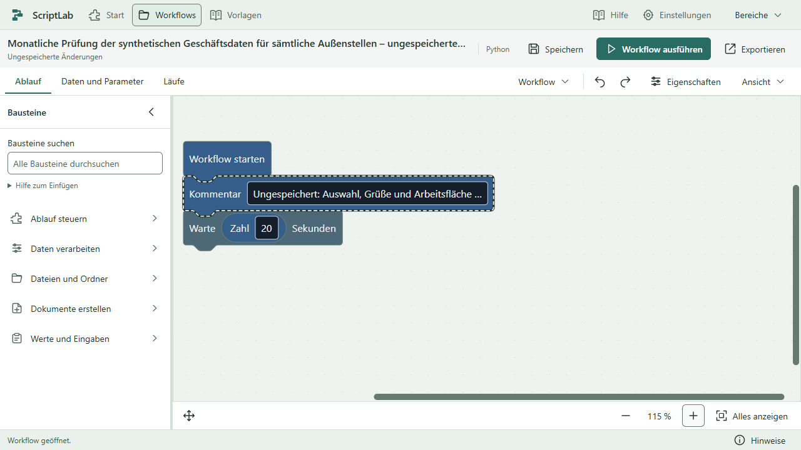
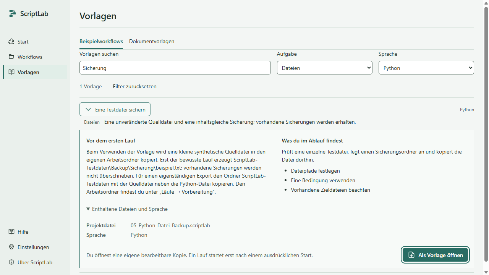
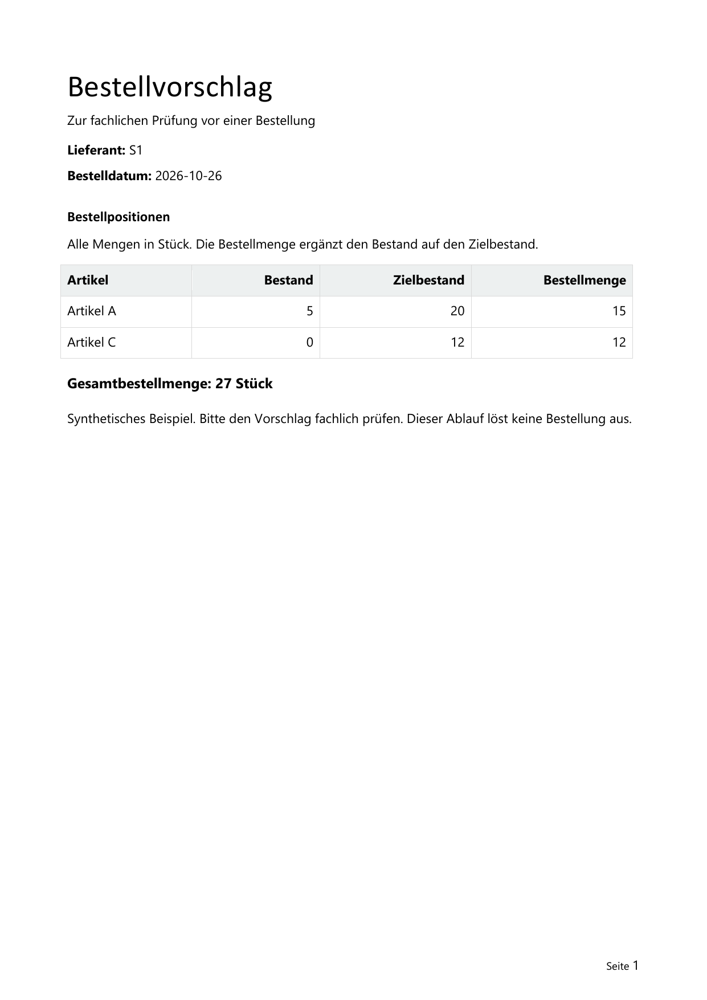

# Lizenz, Vorlagen und Editorstruktur

Durchgang vom 30. Oktober 2026, Ausgang `main` / `58dc3d1` mit sauberem Arbeitsbaum. Nutzerentscheidungen: private nichtkommerzielle Nutzung kostenlos, kommerzielle Nutzung kostenpflichtig; bestehende Vorlagen und UI verbessern; den Aufbau ausdrücklich an Power Automate und n8n orientieren. Keine neue Cloudplattform, Bausteinsammlung, Bibliothek, Zahlungs- oder Aktivierungsinfrastruktur.

## Sichtbares Ergebnis

1. **Globale Ebene:** Start, Workflows, Vorlagen sowie Hilfe/Einstellungen sind im Editor direkt erreichbar. Bei großer Schrift liegen die Unterstützungseinträge weiterhin im sichtbaren Bereiche-Menü.
2. **Workflowebene:** eigener Kopf mit Name, Sprache, Speicherzustand, Speichern, bewusstem Start beziehungsweise Stoppen und Export.
3. **Arbeitsbereich:** Ablauf, Daten und Parameter, Läufe. Der echte Blockly-Canvas bleibt Hauptfläche; links die Palette, rechts bei Bedarf die ausgewählten Eigenschaften. Kein zusätzlicher breiter Navigationsstreifen neben der Palette.

Die Ableitung stammt aus den aktuellen offiziellen Beschreibungen von [Power Automate](https://learn.microsoft.com/en-us/power-automate/desktop-flows/flow-designer), [n8n-Workflowkomponenten](https://docs.n8n.io/build/understand-workflows/workflow-components.md) und [workflowbezogenen Ausführungen](https://docs.n8n.io/build/understand-workflows/understand-executions/view-executions-for-a-single-workflow.md). Es werden Organisationsprinzipien übernommen, keine fremde Marke und keine dort zusätzlich vorhandenen Funktionen vorgetäuscht. [EDITORSTRUKTUR.md](EDITORSTRUKTUR.md) hält Quellen, konkrete Ableitung und Einzelprüfungen fest.

Gemeinsame Farben verwenden gedämpfte Petrolakzente auf Grau-/Grünflächen. Beide Themen, Signet, Wortmarken und daraus erzeugte Windows-Icons stimmen wieder überein. Vorhandene fachliche Blockly-Farben bleiben erhalten. Die bestehenden Kontrastgrenzen wurden nicht abgesenkt. Die unabhängige ICO-Leseprobe bestätigte fünf 32-Bit-PNG-Ressourcen in 16/24/32/48/256 Pixeln, bytegleich zu den separaten PNGs.

Die elf vorhandenen Workflowvorlagen sind nach Suchbegriffen, Aufgabe und Sprache auffindbar. Ergebnis und Sprache lassen sich direkt vergleichen; die ausgewählte Vorlage zeigt Vorbereitung, Inhalt, Dateidetails und die bewusste Kopieraktion. Dokumentvorlagen werden aus derselben Metadatenquelle abgeleitet. Auswahl und Filter bleiben beim Ansichtswechsel erhalten. Die Titel der Grundvorlagen passen zu den tatsächlich geöffneten Workflows.

## Fachliche Vorlagenverbesserungen

Alle sechs Grundvorlagen behalten Dateinamen, bestehende IDs, Schema 1/2 und Sprachzuordnung. Ein erklärender Kommentar ergänzt jeweils den vorhandenen Ablauf. Backup und Dateiliste bekommen erst bei bewusstem Verwenden passende synthetische Eingänge in einem neuen UUID-Arbeitsordner. Eine vorhandene Kennung wird nicht überschrieben. Kein Ergebnis wird vorab mitgeliefert; normale Projektöffnung und reine Vorlagenansicht starten oder kopieren keine Workflowausgaben.

Das Backup meldet eine fehlende Quelle nun als echten Fehler und erreicht dann keine Erfolgsausgabe. Vorhandene Sicherungen bleiben erhalten. Die Dateiliste enthält genau die drei direkten Testdateinamen, keine Unterordnerdatei; der vorhandene ersetzende Schreibschritt ist erklärt. Abschlüsse stehen im Editorprotokoll; die Nachrichtenvorlage bleibt ausdrücklich eine Dialogdemo. Eigenständige Exporte behalten ihren unterstützten Laufzeitkontext und benötigen die Eingangsdateien neben dem Script oder im bewusst gewählten Basisordner. Details: [VORLAGEN-GRUNDLAGEN.md](VORLAGEN-GRUNDLAGEN.md), [VORLAGEN-UI.md](VORLAGEN-UI.md).

Die vorhandene Word-Bestellvorlage verwendet A4, klare Lieferanten-/Datumsangaben, feste lesbare Tabellenbreiten, rechtsbündige Mengen und eine abgesetzte Summe. Alle sieben Tokens, Tabelle 0/Musterzeile 1, zwei Positionen und 15+12=27 Stück bleiben korrekt. Derselbe feste Generator wird auch beim Entwickler-Neuaufbau verwendet; die Gestaltung wird dadurch nicht mehr zurückgesetzt. Keine Absender-, Kontakt- oder Geschäftsdaten wurden erfunden.

## Lizenz und Zuverlässigkeit

[LICENSE.txt](../../LICENSE.txt) erlaubt private nichtkommerzielle Nutzung kostenlos. Kommerzielle Erstellung/Bearbeitung mit ScriptLab erfordert eine separat erworbene kostenpflichtige Lizenz von Leon Stolz. Preis, Umfang und Laufzeit werden gesondert vereinbart. Rechtmäßig erzeugte Exporte benötigen keine zusätzliche Empfängerlizenz; eigene Inhalte und Drittanbieterrechte bleiben getrennt. Der Originaltext steht in „Über ScriptLab“, im Windows-Paket, auf der NSIS-Lizenzseite und im Business-ZIP. Keine Zahlung oder Freischaltung wird technisch vorgetäuscht. [LIZENZ.md](LIZENZ.md) dokumentiert Einbindung, Rechtsquellen und die Grenze des technischen Reviews.

**EINST-01:** Einstellungen und anschließende Sprachwahl konnten im Mainprozess parallel aus einem alten Stand schreiben. Eine geänderte Textgröße konnte dadurch beim schnellen Neuanlegen verloren gehen. Eine kleine lokale Schreibfolge und die erst darin abgeleitete Sprachänderung erhalten beide Werte. Ein Schreibfehler bleibt beim Aufrufer sichtbar und blockiert spätere Aufträge nicht. Der Regressionstest führt tatsächlichen Main-Code mit gezielt verzögertem Schreiben aus; [EINSTELLUNGEN-RACE.md](EINSTELLUNGEN-RACE.md).

Die Startseiten-Testhelfer warten vor Profilneustart und Löschen nun auf das tatsächliche Electron-`close`. Vorlagenprüfungen warten auf neue Identität und bestätigte Darstellung, behalten aber Palette, IDs, Inhalte und Originalschutz als Anforderungen. Keine Frist wurde dafür erhöht, kein richtiger Ansichtswechsel erzwungen; [CI-VORLAGEN.md](CI-VORLAGEN.md).

## Tatsächliche Prüfungen und Grenzen

Windows 11 x64 Build 26200, Node 24.19.0, npm 11.17.0, Electron 45, React 19, Blockly 13, Vitest 5.0.5 und Playwright 1.64.1. App-Laufzeit CPython 3.15.2 mit Tcl/Tk und elf festgelegten Business-Paketen. Der große native Modullauf verwendete den vorhandenen getrennten CPython-3.12.6-Business-venv; er ersetzt die App-Laufzeit nicht. Testdaten und Profile sind synthetisch und isoliert.

| Prüfung | Tatsächliches Ergebnis |
| --- | --- |
| `npm run check`, frischer `npm run build`, Prettier der geänderten Code-/CSS-Dateien, `git diff --check` | Bestanden; bestehende Vite-Warnung zum rund 1,5-MB-Rendererbündel bleibt |
| Vollständiger Modullauf mit `SCRIPTLAB_RUNTIME_TESTS=1` und `SCRIPTLAB_BUSINESS_TESTS=1` | 701 Fälle: **696 bestanden, 0 fehlgeschlagen, 5 optionale Legacy-Installationsfälle übersprungen**; `artifacts/vorlagen-ui/module-gesamt.json` |
| Neue Einstellungsregression nach der späteren Main-Korrektur | **2/2 bestanden**, tatsächlicher Main-Code; zusätzlich eingebettet in den 13/13 bestandenen gezielten Integrationslauf, ohne diese überlappenden Zahlen zu addieren |
| Vollständige Python-Fachsuite nach Word-/Fixture-Änderung | **147/147 bestanden**, 10,523 s; vier neue Ergebnis-/Originalschutz-/Reproduzierbarkeitsfälle eingeschlossen |
| Native Grundvorlagen- und Bestandsprüfung | **33/33 bestanden**, darunter 16 tatsächliche Python-/VBS-Ergebnisproben einschließlich eigenständigem Export, Konflikt, fehlender Quelle und leerem/fehlendem Eingang |
| Gezielte Vorlagen-UI | **5/5 bestanden**, Themen/14 und 28 px tatsächlich geprüft; kein Lauf beim Filtern oder Verwenden, Originalbytes erhalten |
| Gezielte Lizenz-UI | **2/2 bestanden**, beide Themen bei tatsächlichen 200% Text und vollständiger Originaltext |
| Neue Editorstruktur | **4/4 bestanden**: beide Themen, 100/200%, echter Python-Wartelauf und bestätigtes Stoppen, Arbeitsstand/Zoom/Auswahl erhalten |
| Vollständiger Desktoplauf am integrierten Produktstand | **135 bestanden, 1 fehlgeschlagen, 2 optionale Millionenlasten übersprungen**, 441,738 s; alle neuen Vorlagen-/Struktur-/Lizenzfälle und diesmal alle großen Projektfälle bestanden. Einziger Fehler: exakter Gleitkommavergleich der Canvasposition. `artifacts/vorlagen-ui/desktop-abschluss.json` |
| Gezielte vollständige Ziehgruppe nach Präzisierung dieses Vergleichs | **5/5 bestanden**, 13,067 s; `artifacts/vorlagen-ui/ziehen-nachpruefung.json`. Keine Produktänderung danach, kein umetikettierter erfolgreicher 138er-Lauf. |

Vorlage, echte Standardausgabe und Langtext-/Klammerdatenfall wurden mit Word 2021 für Windows nach PDF gerendert, per Poppler als vollständige A4-Seiten angesehen und mit DOCX-/PDF-Readback geprüft. LibreOffice fehlt; die vorhandene sichere Windows-Renderstrecke wurde als dokumentierte Alternative zum Dokumenten-Skill-Standard genutzt. Andere Officeprogramme, beliebige Mehrseitenfälle und echte Unternehmensdaten sind damit nicht geprüft. [VORLAGE-BESTELLUNG.md](VORLAGE-BESTELLUNG.md) enthält die tatsächlichen Renderaufrufe.

Die neue Editorfläche misst bei 1280×720 in beiden Themen **1004×490 Pixel** bei 100% und **1004×401** bei 200%. Das belegt das verbleibende Flächenbudget, keine Leistungssteigerung. Hauptaktionen und Stoppen sind sichtbar. Bestehende weitere DPI-/Tastatur-/Layoutwege gehören zur Gesamtregression, kein Anwender- oder Barrierefreiheitszertifikat.

Ein vorheriger 134er-Zwischenlauf war ausdrücklich rot: **121 bestanden, 6 fehlgeschlagen, 2 optional übersprungen und 5 wegen serieller Vorbedingung nicht ausgeführt**. Fünf Fehler betrafen nach Ergänzung erklärender Kommentarblöcke veraltete Positions-/Anzahlannahmen; die präzisen Anforderungen wurden angepasst. Der sechste Fehler betraf den bestehenden intermittierenden 1000er-Wiederladestillstand. Kein Zwischenlauf wird als vollständige Abnahme addiert. Ein fehlerhafter erster Lizenz-Testaufbau und die erste falsche Hilfe-H1-Erwartung sind in den Fachberichten getrennt erhalten.

Der spätere einzige 138er-Fehler war `y=-5,684341886080802e-14` statt `0` nach dem Ablegen eines Blocks. Vor dem Ablegen bleibt der Vergleich exakt, ebenso der Zoom. Nach dem Ablegen prüfen x/y mit neun Dezimalstellen, also weniger als 5×10⁻¹⁰ logischen Pixeln Toleranz. Das lässt keine praktisch wahrnehmbare Verschiebung zu; unabhängiger Read-only-Review bestätigte die Anforderung. Eine erste Nachprüfung änderte versehentlich nur den Vorabvergleich und blieb deshalb 4/5 rot; diese Änderung wurde zurückgenommen und ausschließlich der betroffene Vergleich nach dem Ablegen präzisiert. Danach bestand die gesamte Ziehgruppe. Marker, tatsächliche Startblockposition, Verbindung, Escape und Undo/Redo bleiben zusätzlich geprüft. Keine Frist oder Produktlogik wurde dafür verändert.

**Offen:** Die 1000er-Linearfolge scheiterte auch im vorherigen Remote-Stand `58dc3d1` beim Wiederladen; eine einzelne Bridge-Auswertung blieb offen. Andere Läufe desselben Falls bestanden. Der alte Text „Mein Workflow“ war nur der letzte zurückgekehrte Pollwert, kein Beleg für eine Rücksetzung des Main-Projekts. Eine ursächliche Behebung wird durch die jetzigen UI-Änderungen nicht behauptet. Das 1000er-Gesamtmaximum, die 150er-Verschachtelungsgrenze sowie die frühe Ablehnung von 2000 bleiben bestehen; keine verlässlich unbegrenzte oder durchgehend störungsfreie 1000er-Unterstützung. Der konkrete Diagnosebedarf steht im bestehenden [Backlog](../UMSETZUNG.md), ohne Testdeaktivierung oder Fristanhebung.

Der bekannte fehlende vollständige Drittanbietertext für `lazy-val@1.0.5` bleibt offen. Die eigene Lizenz löst ihn nicht. Keine neuen Preise, Rechtsgutachten, Signaturen, Installations-/Updateabnahme oder Cloud-/SaaS-Reife behauptet. Der endgültige lokale NSIS-Build wird nach dem Dokumentationscommit ohne Veröffentlichung gebaut und mit dem vorhandenen Paketprüfer sowie isoliertem Paketstart geprüft. Sein konkreter Bericht mit Quellstand/Hashes liegt beim jeweiligen `release`-Ordner; er ist von diesem eingebetteten Quellenbericht getrennt, damit keine selbstbezüglichen Installerhashes entstehen.

## Zusammenarbeit und Git

Drei echte Fachagenten: Bedienung verantwortete Vorlagenliste und anschließend den getrennten Editorrahmen; Ausführung ausdrücklich Python/VBS-Grundvorlagen und unabhängigen Lizenz-/Kopierreview; Businessdaten die Wordvorlage und anschließend die echte Einstellungsregression. Ein zusätzlicher reiner Lese-Review prüfte den Strukturschnitt. Root verantwortete Lizenz, zentrale Tokens/Icons, Main-Kopier-/Schreibverträge, Integration, tatsächliche zentrale Nachprüfungen und alle Gitaktionen. Fachaufträge, Besitz, Befunde und Fortsetzungspunkte stehen in den verlinkten Berichten. Kein Fachagent führte Commit, Push oder konkurrierenden Build aus.

Bereits bestätigte Pushes auf `origin/main`:

- `2931456` – Private Nutzung freigegeben und kommerzielle Lizenz geregelt
- `f2f7591` – Bestellvorlage lesbarer und reproduzierbar gestaltet
- `9e07c77` – Darstellungseinstellungen beim Workflowwechsel erhalten
- `ce0a6fc` – Vorlagen einfacher auswählen und mit Testdaten verwenden
- `7fbe266` – Globale Navigation und Workflowebenen klar getrennt
- `a30eef2` – Rundungsrauschen bei Canvaspositionen korrekt geprüft

Abschließende Nachweisedits erhalten einen eigenen deutschen Commit. Aktueller Remote-/CI-Status wird im Abschluss separat live geprüft; frühere rote oder laufende GitHub-Prüfungen werden nicht als grün ausgegeben. Keine Tags, Releases, Force-Pushes oder neuen Abhängigkeiten.
